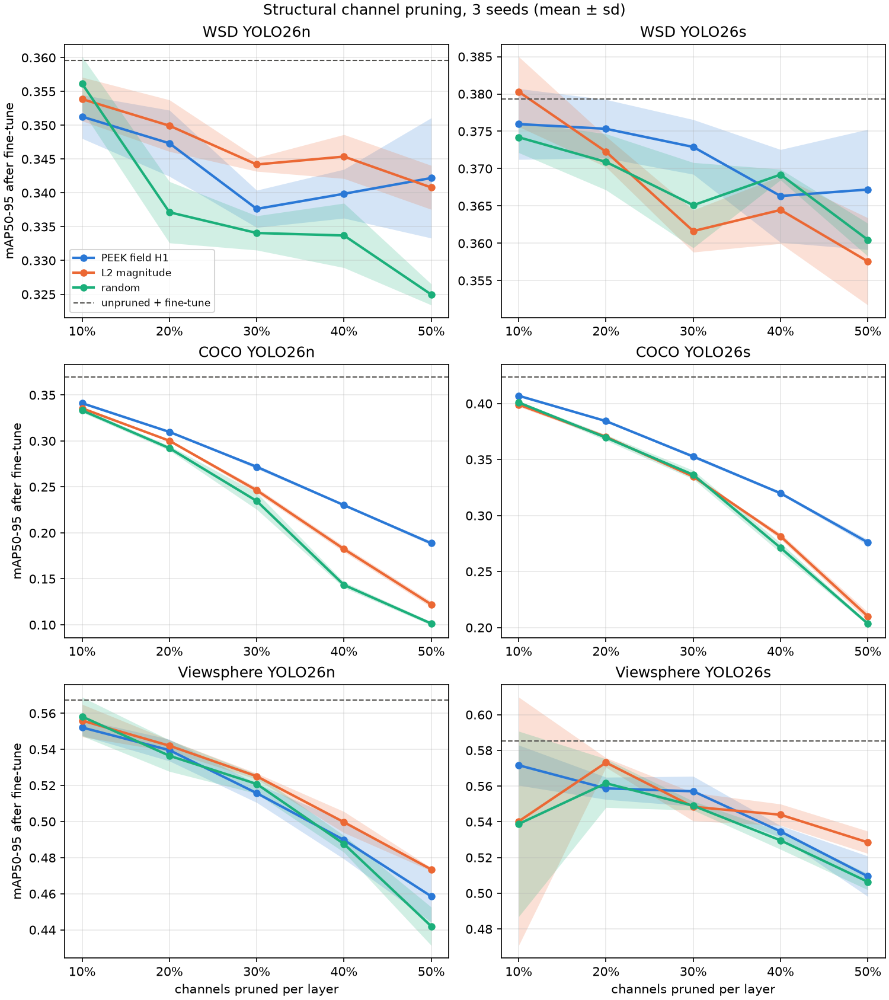
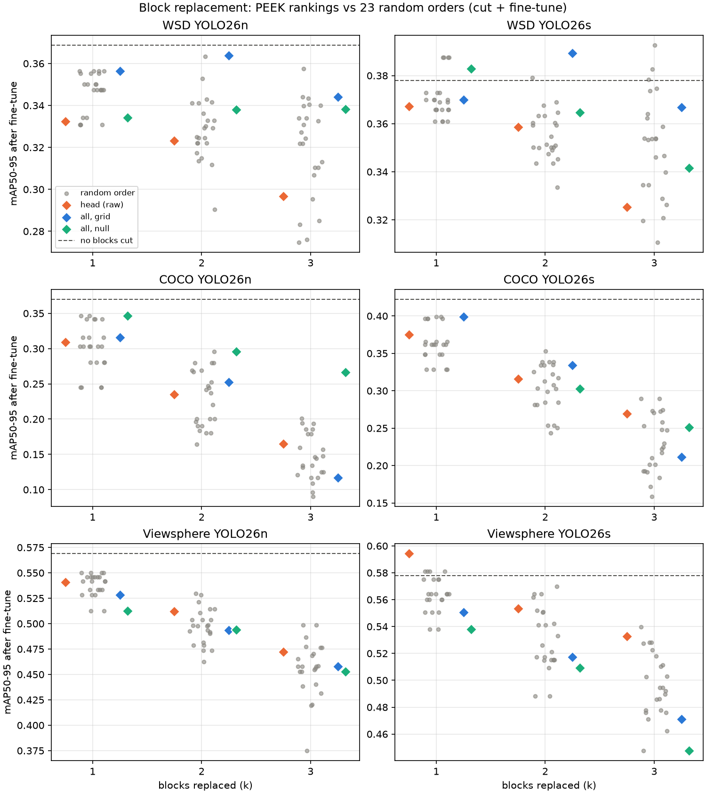
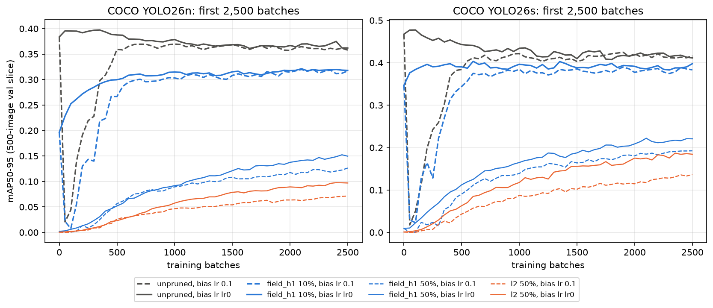
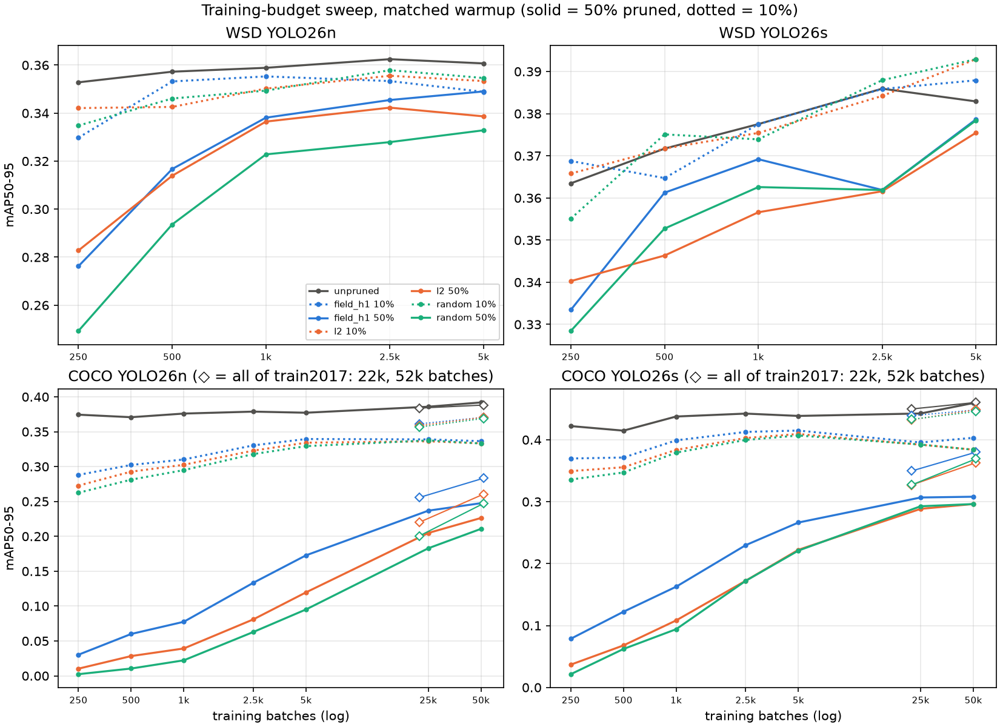

# TiNA — topology-guided pruning of YOLO26 detectors

Code, configs, and results for two pruning studies on YOLO26n/s that ask whether
**persistent-homology (H0 / H1) structure in a detector's PEEK maps identifies
what can be pruned** — and whether reading the topology from PEEK maps does better
than reading it from the raw activations. Both bases are run on one setup (same
models, seed, calibration images and fine-tune) and reported side by side:

1. **Structural channel pruning** (`structural_pruning/`) — filters are physically
   removed with Torch-Pruning, ranked by the H0 / H1 persistence of PEEK maps (two
   variants), against L2-magnitude and random baselines.
2. **Block replacement** (`block_pruning/`) — whole head `C3k2` blocks whose PEEK
   map is least persistent are replaced by a 1×1 conv and the model is retrained
   from scratch.

Data: **WSD v71** (satellite components: `antenna, body, solar, thruster`; 1,005
train / 186 val images; private, not included) and four **synthetic shape**
datasets generated by `block_pruning/make_shapes.py`; and **COCO 2017** (the pretrained
YOLO26n/s, fine-tuned on a fixed 10k-image train2017 subset and evaluated on val2017).

> **Status: exploratory.** Every number is a single seed (42) on the validation
> split unless stated; the test split was never evaluated. Random pruning was
> repeated on every model over 10 masks (before fine-tuning) and 3 seeds (after),
> which is the yardstick for noise below. *WSD and COCO on the same protocol* uses
three independent seeds (42/43/44) throughout.

## Key findings

- **How fast pruned models recover depends on the dataset more than the method.** WSD
  is back within ~0.01 mAP50-95 of its best after 500–1,000 training batches (8–16
  epochs); the 20-epoch recipe is ample. On COCO the 10k-image fine-tune subset was much
  of the ceiling: fine-tuned on all of train2017, 10% channel pruning reaches 95–97% of
  the unpruned model given the same fine-tune and the best single-block cut 96%, while
  50% pruning stays at 64–83% and is still climbing after 7 epochs. PEEK field H1
  recovers fastest; with full data its lead at 50% is still about +0.02 over L2, while L2
  is within ±0.013 of random there. See *How fast pruned models recover*.
- **Ultralytics' default warmup crashes every COCO model.** It starts the bias learning
  rate at 0.1 (800× COCO's lr0): within 50 batches the unpruned YOLO26n falls from 0.38
  to 0.02 mAP50-95 and needs ~500 batches to come back. Starting it at lr0 removes the
  crash and ends as high or higher at nearly every budget; this *matched warmup* is our standard from the
  recovery study on (the 20-epoch tables predate it).
- **Fewer GFLOPs is not faster.** On an A100, channel pruning changes batch-1 latency by
  only −5% to +4% at any ratio and *lowers* batch-32 throughput by 8–10% at 10–20%;
  replacing a block cuts latency by 8–14% per block (−21% to −28% at three). On CPU,
  channel pruning helps only from 30% (−13% to −17% at 50%) and blocks save 6–11% each.
- **On COCO, PEEK field topology beats L2 magnitude and random pruning at every
  ratio, on both models, over 3 seeds.** PEEK field H1 vs L2 after the 20-epoch
  fine-tune: 0.341 vs 0.336 at 10% rising to 0.189 vs 0.122 at 50% (YOLO26n), and 0.407
  vs 0.399 up to 0.276 vs 0.210 (YOLO26s); seed sd ≤ 0.009. All three field criteria
  behave alike. On WSD, with the same three independent seeds, field H1 and L2 are
  within noise of each other (mean over ratios: n 0.344 vs 0.347, s 0.372 vs 0.367), both
  ahead of random on n. See *WSD and COCO on the same protocol*.
- **Block replacement over all eight C3k2 blocks needs map-size normalization, and no
  normalization wins on both datasets.** The raw ranking sorts blocks by resolution
  and is at or below the random median. Under cut + fine-tune the common-grid ranking
  beats 78–100% of 23 random block orders on WSD in 5 of 6 cases but only 13–91% on
  COCO; the shuffled-null ranking is best on COCO YOLO26n (91 / 96 / 100%) and
  inconsistent elsewhere.
- **Layer-level (field) topology beats random pruning before fine-tuning, on
  either basis.** On WSD the field criteria lie above *every one* of 10 random masks
  at 10–30% per-layer pruning on YOLO26n, +0.02–0.045 mAP50-95 over the random
  mean on both models. At 40–50% all criteria collapse towards zero.
- **PEEK field H1 in particular beats random in the large majority of cases before
  fine-tuning:** above the random mean in 10/10 WSD (model, ratio) pairs and above
  all 10 random masks in 9/10 (+0.040 mAP50-95 on average); on the shapes, above the
  random mean in 37/40 pairs and above all 10 masks in 21/40 (+0.087). After
  fine-tuning it is above the random mean in 8/10 WSD pairs but by only +0.005,
  inside the seeds' spread, and in 18/40 shape pairs. Per-channel H1 is below random
  (1/10 WSD, 3/40 shapes before fine-tuning). See *H1 criteria vs random pruning*
  below.
- **On the synthetic shapes field topology also beats L2 magnitude before
  fine-tuning:** mean mAP50-95 0.68–0.72 (both bases) vs 0.65 (L2) and 0.62 (random,
  10-mask mean). On WSD, L2 still leads from 20% upward; at 10% field and L2 are level.
- **Recovery during the fine-tune:** on WSD-n the field criteria start ahead of
  random (epoch 1: 0.25 vs 0.23) and stay ~0.01 ahead through epoch 5, but L2 is the
  only method that recovers 95% of the unpruned accuracy in every WSD run; random
  never gets there in 10 of its 30 WSD runs. See *Recovery during the fine-tune*.
- **PEEK maps do not improve on raw activations.** At the field level the two bases
  are equivalent: mean Δ (PEEK − activation) between −0.022 and +0.025 before
  fine-tuning, with wins split, and ≈0 after. Per channel, PEEK is mostly worse
  (WSD −0.02 to −0.04; shapes H0 −0.31), the exception being per-channel H1 on the
  shapes (+0.14). PEEK keeps the field-level signal; it does not add to it.
- **Per-channel persistence is not a useful criterion on either basis:** at or
  below random on WSD, and well behind the field criteria on the shapes.
- **On WSD and the shapes, after a 20-epoch fine-tune the gaps close** (not on COCO, above). Every criterion, either basis, ends
  within ~0.01 mAP50-95 of the others — about the spread of the random seeds
  (WSD-n: field 0.341–0.347, L2 0.346, random 0.338 over 3 seeds). The shapes
  saturate (≈0.98) for every criterion.
- **Block replacement:** both bases and all three rankings pick the same WSD blocks
  (22 → 13 → 19), and the shapes cut sets differ in a single case. Cutting three
  blocks saves 12–13% GFLOPs with no measurable mAP loss.
- **Channel pruning vs block replacement on WSD:** block replacement gets ~12–13%
  fewer GFLOPs at no mAP cost; channel pruning goes to ~28% at 0.00–0.03 mAP50-95.
  Channel pruning is also 10–25× cheaper to recover: within 5% of its reference in
  ~10–16 epochs (2–3 min), against 150–430 epochs (25–78 min) for a block-cut model
  retrained from scratch, whose patience-100 training then runs 390–970 epochs. See
  *Channel pruning vs block replacement* and *Convergence* below.

## Layout

```
src/topoprun/                       canonical PEEK adapter + PEEK-map persistence (from PEEK-TiNA)
structural_pruning/
  peek_rvc_pruning/yolo_tda.py      PEEK-map persistence scoring + Torch-Pruning importance
  peek_rvc_pruning/iter_probe.py    evaluate a fine-tune every N batches (recovery probes)
  scripts/run_yolo26_tda_pruning.py stages: baseline | score | score-field | prune | aggregate | grid
  scripts/verify_yolo26_pruning.py  structural-vs-zeroed equivalence + single-layer checks
  scripts/bench_inference.py        forward-pass timing of every pruned model, GPU and CPU, round-robin
  scripts/profile_cpu_layers.py,    how a CPU timing artifact was traced (per-layer profile;
    cpu_interleave.py               models timed one after another vs interleaved)
  scripts/slurm/                    score + score-field -> prune array -> aggregate chain
  configs/coco/                     COCO yamls (placeholder paths), the 10k fine-tune subset list,
                                    its 40% / 80% prefixes and the 500-image val slice (recovery study)
  scripts/slurm/same_protocol/      submission scripts for the WSD + COCO same-protocol runs, as run
                                    on our cluster (edit the paths at the top); submit_recovery.sh =
                                    the recovery study (probes, budget sweep, full train2017)
block_pruning/                      block-replacement study (own README)
  finetune_init.py                  cut + fine-tune: copy every surviving tensor from the trained model
  eval_cut_prefinetune.py           mAP of each ranked cut right after the cut, before any training
  weights/                          8 synthetic-shape base models — not in the repo, see weights/README.md
scripts/
  train_wsd_baselines.slurm         scratch YOLO26n/s on WSD (starting checkpoints)
  collect_results.py                copies the cluster outputs into results/
  make_results_tables.py            regenerates the tables below from results/
  collect_same_protocol.py          WSD + COCO same-protocol runs -> results/same_protocol/*.csv
  same_protocol_tables.py           that section's tables + figures from results/same_protocol/
  recovery_tables.py                recovery-study and inference-timing tables + figures
results/
  structural_pruning/peek/<model>/        wsd_{n,s} and shapes_<dataset>_{n,s}: full 41-run grid
                                          (results.csv, map_vs_ratio.png, per-run JSON,
                                          curves.csv = per-epoch val mAP, per-layer persistence CSVs,
                                          args/ = each fine-tune's Ultralytics args.yaml)
  structural_pruning/activation/<model>/  the 6 TDA criteria on the activation basis (l2 /
                                          random / none are basis-independent: see peek/)
  structural_pruning/random_spread/       random masks for every model: 10 one-shot seeds,
                                          20-epoch seeds 43/44 (+ their curves)
  block_pruning/{peek,activation}/        rankings + results.csv (shapes + WSD) per basis
  block_pruning/runs/, args/, curves/     the trained cut models both bases point at, + their args
                                          and per-epoch training logs
  base_models/                            training args of the 10 starting checkpoints
  same_protocol/                          channel_runs.csv, block_runs.csv (every WSD + COCO run of
                                          that section, incl. the COCO lr pilot), curves.csv (their
                                          per-epoch val mAP), probe_curves.csv, budget_runs.csv,
                                          inference_{gpu,cpu}.csv, figures/
```

## Method

### PEEK maps and their topology

For a layer's activations `A` (C × H × W, after Conv → BN → SiLU) the PEEK map is
the canonical pseudo-entropy from the [PEEK package](https://github.com/Kenzie-Meni/PEEK)
(`peek.core.PEEK`, called through `topoprun.peek_adapter`; the equation is not
reimplemented): `A` is shifted by its global minimum to be positive and
`Σ_c x_c log x_c` is taken over channels at every pixel. It is computed on the
full-resolution activations, then average-pooled to at most 64×64, min-max
normalised, and analysed with a superlevel cubical filtration (`topoprun.topology`,
`gudhi`; high-PEEK cells enter first). H0 bars are blobs, H1 bars are holes ringed
by high PEEK; only finite bars count.

**Activation basis (comparison, `--basis activation`).** The same criteria read the
raw activations instead: a channel's own post-SiLU map (pooled to ≤64×64, not
normalised) for the per-channel criteria, and the layer field √(Σ_c a_c²), min-max
normalised, for the field criteria and the block ranking. Everything else is
identical.

### Structural channel pruning

Prunable convs are every `Conv` in layers 6+; layers 0–5 (stem → stride-16), the
`Detect` head, and PSA attention layers are never pruned. Each `C3k2`/`C2PSA`
`cv1(x).chunk(2)` is first rewritten as two half-width convs (identical output) so
Torch-Pruning can trace it. Scores are averaged over 128 letterboxed **train** images.

| Criterion | Map analysed | Channel score (lowest pruned first) |
|---|---|---|
| `h0` / `h1` / `total` (per-channel) | the PEEK map of that channel alone | mean finite H0 / H1 / H0∪H1 bar lifetime |
| `field_h0` / `field_h1` / `field_total` | the layer's PEEK map | \|Δ total H0\| / \|Δ total H1\| / their sum when that channel is left out of the map |
| `l2` | — | filter L2 magnitude |
| `random` | — | random order |
| `none` | — | unpruned control, same BN re-estimation and fine-tune |

Within each layer the lowest-scoring 10–50% of channels are removed structurally
(`MetaPruner`, per-layer ratio); coupled channels (residual adds, concats) are pruned
as a group scored by the members' mean. Each run then re-estimates BN statistics on
128 train images and fine-tunes 20 epochs (1 warmup epoch, batch 16, seed 42); mAP is
recorded after pruning, after BN re-estimation, and after fine-tuning. Pruned
checkpoints contain physically smaller layers and no zeroed filters. Because protected
layers are untouched, 50% per-layer removes ~39% of parameters and ~28% of GFLOPs.

### Block replacement

The four head `C3k2` blocks (13, 16, 19, 22) are ranked by the persistence of each
block's PEEK map over 40 images: secondary-peak H0 prominence, H1 pocket
persistence, or their normalised 50/50 blend (`combined`). The k = 1, 2, 3 lowest are
replaced by a 1×1 `Conv` of the same width, and every model (including k = 0) is
trained from scratch. A cut model depends only on *which* blocks are cut, so each
(ranking, k) row reuses the trained model with exactly that cut set (`source_run` in
`results/block_pruning/results.csv`); only cut sets no earlier run covered were
trained. Details in [`block_pruning/README.md`](block_pruning/README.md).

## Training configuration

Every model is trained with Ultralytics 8.4.9 at 640 px. Every configuration is
committed: `results/base_models/` for the starting checkpoints, and an `args/` folder
next to each result set with every run's full Ultralytics `args.yaml` (machine-local
paths reduced to file names).

| Stage | Models | Epochs | Batch | Resolved optimizer | Seed | Deterministic | AMP | Warmup |
|---|---|---|---:|---|---|---|---|---:|
| WSD base models (scratch) | YOLO26n, YOLO26s | 1000, patience 100 (stopped at 438 / 409) | 16 | MuSGD, lr 0.01 | 42 | yes | yes | 3 |
| Shapes base models (scratch) | YOLO26n/s × 4 datasets | 40, patience 100 | 32 | AdamW (derived, see below) | 42 | circles n/s and triangles n only | yes | 3 |
| Pruning fine-tune | all 10 | 20 | 16 | AdamW, lr 0.00125 (WSD), 0.002 (circles / triangles / squares), 0.001429 (mixed) | 42; random also 43, 44 | yes | yes | 1 |
| Block cuts, shapes | 4 datasets × n/s × k | 60, patience 100 | 32 | AdamW, lr 0.002 / 0.001429 (mixed) | 42 | no | no | 3 |
| Block cuts, WSD | n, s × k | 1000, patience 100 | 16 | MuSGD, lr 0.01 | 42 | yes | yes | 3 |
| Same protocol: channel fine-tune, WSD | n, s | 20 | 16 | AdamW, lr 0.00125, momentum 0.9 (set explicitly) | 42, 43, 44 (loader seeded) | yes | yes | 1 |
| Same protocol: channel fine-tune, COCO | pretrained n, s | 20 on the 10k train2017 subset | 16 | AdamW, lr 0.000125, momentum 0.9 | 42, 43, 44 (loader seeded) | yes | yes | 1 |
| Same protocol: block cut + fine-tune | WSD and COCO n, s × k | 20, patience 100 | 16 | AdamW, lr 0.00125 (WSD) / 0.000125 (COCO) | 42 | yes | yes | 1 |
| Recovery: probes | 79 configs (below) | 20 (COCO: first 2,500 batches) | 16 | as the same protocol; bias lr 0.1 and = lr0 | 42 | yes | yes | 1 |
| Recovery: budget sweep | same 79 | 250 – 5,000 batches; COCO also 25k, 50k | 16 | as the same protocol, bias lr = lr0 | 42 | yes | yes | 5% of the run |
| Recovery: COCO, all of train2017 | 24 COCO configs | 3 and 7 epochs (22k / 52k batches) | 16 | AdamW, lr 0.000125, bias lr = lr0 | 42 | yes | yes | 5% of the run |

- **Optimizer.** Every stage runs `optimizer=auto`, which ignores `lr0` / `momentum`
  and picks by run length: MuSGD (lr 0.01, momentum 0.9) above 10,000 iterations,
  otherwise AdamW (momentum 0.9) with lr 0.002·5/(4 + classes). The resolved values
  above are read from the training logs; the shapes base models were trained on a
  workstation whose logs were not kept, so theirs is derived from the same rule
  (40 epochs on 800 images stays far below 10,000 iterations).
- **Shared defaults.** Weight decay 5e-4; loss gains box 7.5 / cls 0.5 / dfl 1.5;
  augmentation: mosaic 1.0 (closed for the last 10 epochs), HSV 0.015 / 0.7 / 0.4,
  translate 0.1, scale 0.5, horizontal flip 0.5, no mixup / copy-paste.
- **Shapes data.** 800 train images per dataset (`block_pruning/make_shapes.py`). The
  base models came from PEEK-TiNA's `elementary-shapes` (same generator, 2026-09-01).
- **Train-loader seed.** Ultralytics seeds the training loader's generator with a
  constant, so `--seed` does not change the batch order. The same-protocol runs offset
  it by `seed − 42` (seed 42 unchanged); the earlier *random spread* seeds 43/44 predate
  this and differ only in their random mask.
- **COCO learning rate.** The WSD lr (1.25e-3) drops the pretrained, unpruned YOLO26n
  from 0.400 to 0.308 mAP50-95 over the fine-tune; 1.25e-4 keeps it at 0.370 (pilot table
  in the same-protocol section), so COCO uses 1.25e-4. Everything else matches WSD.
- **Warmup bias lr (matched warmup).** Ultralytics starts the bias parameters' lr at
  `warmup_bias_lr` = 0.1 and decays it to lr0 over the warmup, whatever lr0 is. The
  recovery study sets it to lr0 (`--warmup-bias-lr`), which is our standard from there
  on; every 20-epoch table above uses the default. Budget runs warm up over 5% of the
  run (Ultralytics' floor: 100 batches) and close mosaic for the second half; COCO
  budgets under two epochs train on the first 40% / 80% of the 10k subset
  (= Ultralytics `fraction`, as their own folders so each has its own label cache).
- **Before every fine-tune** BN statistics are re-estimated on 128 train images
  (one-shot results stop here: no fine-tune, so no `args.yaml`).
- **Hardware.** Cluster jobs ran on one A100 (40 GB) each — everything except the
  shapes base models, which were trained on a workstation. Data-loader workers: 16 for
  the fine-tunes, 8 for block cuts and WSD base models.

## Results

Tables generated by `python scripts/make_results_tables.py` from `results/`.
Bold = best criterion at that pruning ratio.

### Structural channel pruning (WSD)

† = above every random mask at that ratio (10 one-shot masks before fine-tuning; seeds 42/43/44 after).

#### YOLO26n — unpruned 5.70 GFLOPs; mAP50-95 0.352 (BN re-estimated), 0.356 (20-epoch fine-tune)

GFLOPs at 10 / 20 / 30 / 40 / 50 % per-layer pruning: 5.28 / 4.94 / 4.63 / 4.35 / 4.12

**mAP50-95, before fine-tuning (pruned + BN re-estimated)**

| Criterion | 10% | 20% | 30% | 40% | 50% | Mean | Δ vs L2 | Δ vs random mean | Mean mAP50 |
|---|---:|---:|---:|---:|---:|---:|---:|---:|---:|
| PEEK field H0 | 0.285† | 0.195† | 0.105† | 0.026 | 0.006 | 0.124 | -0.046 | +0.032 | 0.204 |
| PEEK field H1 | 0.289† | 0.206† | 0.096† | 0.028† | 0.017† | 0.127 | -0.043 | +0.035 | 0.215 |
| PEEK field H0+H1 | 0.292† | 0.204† | 0.111† | 0.019 | 0.004 | 0.126 | -0.044 | +0.034 | 0.204 |
| PEEK per-channel H0 | 0.196 | 0.074 | 0.022 | 0.008 | 0.002 | 0.060 | -0.109 | -0.032 | 0.111 |
| PEEK per-channel H1 | 0.158 | 0.070 | 0.019 | 0.006 | 0.007 | 0.052 | -0.118 | -0.040 | 0.109 |
| PEEK per-channel H0+H1 | 0.188 | 0.058 | 0.026 | 0.020 | 0.012† | 0.061 | -0.109 | -0.031 | 0.119 |
| Activation field H0 | 0.284† | 0.215† | 0.120† | 0.036† | 0.015† | 0.134 | -0.036 | +0.042 | 0.222 |
| Activation field H1 | 0.275† | 0.193† | 0.111† | 0.050† | 0.010 | 0.128 | -0.042 | +0.036 | 0.222 |
| Activation field H0+H1 | **0.298†** | 0.209† | 0.121† | 0.039† | 0.015† | 0.137 | -0.033 | +0.045 | 0.227 |
| Activation per-channel H0 | 0.212 | 0.095 | 0.052 | 0.013 | 0.002 | 0.075 | -0.095 | -0.018 | 0.127 |
| Activation per-channel H1 | 0.209 | 0.084 | 0.020 | 0.009 | 0.004 | 0.065 | -0.105 | -0.027 | 0.128 |
| Activation per-channel H0+H1 | 0.210 | 0.099 | 0.032 | 0.009 | 0.005 | 0.071 | -0.099 | -0.021 | 0.126 |
| L2 magnitude | 0.291† | **0.234†** | **0.165†** | **0.096†** | **0.062†** | 0.170 | — | +0.078 | 0.283 |
| Random (seed 42) | 0.256 | 0.143 | 0.056 | 0.014 | 0.006 | 0.095 | -0.075 | +0.003 | 0.173 |
| Random, 10 seeds: mean (min–max) | 0.243 (0.221–0.269) | 0.141 (0.111–0.167) | 0.054 (0.026–0.067) | 0.017 (0.011–0.027) | 0.005 (0.001–0.011) | 0.092 | -0.078 | — | — |

**mAP50-95, after 20-epoch fine-tune**

| Criterion | 10% | 20% | 30% | 40% | 50% | Mean | Δ vs L2 | Δ vs random mean | Mean mAP50 |
|---|---:|---:|---:|---:|---:|---:|---:|---:|---:|
| PEEK field H0 | 0.354 | 0.356† | 0.346† | 0.335 | 0.339† | 0.346 | +0.000 | +0.008 | 0.480 |
| PEEK field H1 | 0.355 | 0.348† | 0.335 | 0.339 | **0.352†** | 0.346 | +0.000 | +0.008 | 0.488 |
| PEEK field H0+H1 | 0.356 | 0.346† | 0.344† | 0.337 | 0.328 | 0.342 | -0.004 | +0.004 | 0.480 |
| PEEK per-channel H0 | 0.347 | 0.343 | 0.332 | 0.335 | 0.334 | 0.338 | -0.007 | -0.000 | 0.480 |
| PEEK per-channel H1 | 0.348 | 0.338 | 0.331 | 0.337 | 0.327 | 0.336 | -0.010 | -0.002 | 0.475 |
| PEEK per-channel H0+H1 | 0.344 | 0.334 | 0.338† | 0.344† | 0.335† | 0.339 | -0.007 | +0.001 | 0.480 |
| Activation field H0 | **0.365†** | 0.350† | **0.349†** | 0.338 | 0.334 | 0.347 | +0.001 | +0.009 | 0.483 |
| Activation field H1 | 0.355 | **0.357†** | 0.333 | 0.335 | 0.335† | 0.343 | -0.003 | +0.005 | 0.482 |
| Activation field H0+H1 | 0.358† | 0.345† | 0.338† | 0.333 | 0.333 | 0.341 | -0.004 | +0.003 | 0.478 |
| Activation per-channel H0 | 0.362† | 0.340 | 0.332 | 0.338 | 0.343† | 0.343 | -0.003 | +0.005 | 0.480 |
| Activation per-channel H1 | 0.352 | 0.352† | 0.330 | 0.334 | 0.335† | 0.341 | -0.005 | +0.002 | 0.483 |
| Activation per-channel H0+H1 | 0.354 | 0.340 | 0.337 | 0.330 | 0.329 | 0.338 | -0.008 | -0.000 | 0.474 |
| L2 magnitude | 0.350 | 0.346† | 0.343† | **0.349†** | 0.341† | 0.346 | — | +0.007 | 0.480 |
| Random (seed 42) | 0.356 | 0.338 | 0.332 | 0.328 | 0.325 | 0.336 | -0.010 | -0.002 | 0.475 |
| Random, 3 seeds: mean (min–max) | 0.354 (0.353–0.356) | 0.341 (0.338–0.343) | 0.334 (0.332–0.337) | 0.334 (0.328–0.340) | 0.328 (0.325–0.334) | 0.338 | -0.007 | — | — |

#### YOLO26s — unpruned 22.36 GFLOPs; mAP50-95 0.380 (BN re-estimated), 0.388 (20-epoch fine-tune)

GFLOPs at 10 / 20 / 30 / 40 / 50 % per-layer pruning: 20.76 / 19.39 / 18.11 / 17.00 / 16.04

**mAP50-95, before fine-tuning (pruned + BN re-estimated)**

| Criterion | 10% | 20% | 30% | 40% | 50% | Mean | Δ vs L2 | Δ vs random mean | Mean mAP50 |
|---|---:|---:|---:|---:|---:|---:|---:|---:|---:|
| PEEK field H0 | **0.346†** | 0.276† | 0.149 | 0.047 | 0.018† | 0.167 | -0.053 | +0.023 | 0.270 |
| PEEK field H1 | 0.335 | 0.277† | 0.206† | 0.091† | 0.034† | 0.189 | -0.031 | +0.044 | 0.300 |
| PEEK field H0+H1 | 0.343† | 0.283† | 0.155 | 0.040 | 0.021† | 0.168 | -0.052 | +0.024 | 0.271 |
| PEEK per-channel H0 | 0.242 | 0.102 | 0.026 | 0.007 | 0.002 | 0.076 | -0.144 | -0.069 | 0.127 |
| PEEK per-channel H1 | 0.204 | 0.087 | 0.035 | 0.014 | 0.004 | 0.069 | -0.151 | -0.076 | 0.127 |
| PEEK per-channel H0+H1 | 0.219 | 0.116 | 0.042 | 0.021 | 0.003 | 0.080 | -0.140 | -0.064 | 0.139 |
| Activation field H0 | 0.341† | 0.266 | 0.175† | 0.085† | 0.021† | 0.178 | -0.042 | +0.033 | 0.285 |
| Activation field H1 | 0.330 | 0.280† | 0.198† | 0.104† | 0.015† | 0.185 | -0.034 | +0.041 | 0.290 |
| Activation field H0+H1 | 0.344† | 0.273† | 0.203† | 0.097† | 0.030† | 0.189 | -0.030 | +0.045 | 0.298 |
| Activation per-channel H0 | 0.307 | 0.215 | 0.106 | 0.028 | 0.018† | 0.135 | -0.085 | -0.010 | 0.220 |
| Activation per-channel H1 | 0.281 | 0.172 | 0.045 | 0.006 | 0.004 | 0.101 | -0.119 | -0.043 | 0.159 |
| Activation per-channel H0+H1 | 0.297 | 0.215 | 0.087 | 0.027 | 0.011 | 0.127 | -0.093 | -0.017 | 0.206 |
| L2 magnitude | 0.341† | **0.293†** | **0.233†** | **0.148†** | **0.084†** | 0.220 | — | +0.075 | 0.349 |
| Random (seed 42) | 0.312 | 0.205 | 0.087 | 0.022 | 0.002 | 0.126 | -0.094 | -0.019 | 0.192 |
| Random, 10 seeds: mean (min–max) | 0.313 (0.296–0.340) | 0.241 (0.226–0.272) | 0.127 (0.082–0.159) | 0.036 (0.024–0.050) | 0.006 (0.004–0.011) | 0.145 | -0.075 | — | — |

**mAP50-95, after 20-epoch fine-tune**

| Criterion | 10% | 20% | 30% | 40% | 50% | Mean | Δ vs L2 | Δ vs random mean | Mean mAP50 |
|---|---:|---:|---:|---:|---:|---:|---:|---:|---:|
| PEEK field H0 | 0.382 | 0.373 | 0.365 | 0.366 | 0.353 | 0.368 | -0.002 | -0.001 | 0.502 |
| PEEK field H1 | 0.380 | 0.372 | **0.373†** | **0.369†** | 0.358 | 0.370 | +0.001 | +0.002 | 0.505 |
| PEEK field H0+H1 | 0.376 | 0.374 | 0.361 | 0.359 | 0.359 | 0.366 | -0.004 | -0.003 | 0.502 |
| PEEK per-channel H0 | **0.387†** | 0.373 | 0.368† | 0.369† | **0.385†** | 0.376 | +0.007 | +0.008 | 0.517 |
| PEEK per-channel H1 | 0.382 | 0.370 | 0.358 | 0.359 | 0.368† | 0.367 | -0.002 | -0.001 | 0.510 |
| PEEK per-channel H0+H1 | 0.376 | 0.375 | 0.369† | 0.368 | 0.381† | 0.374 | +0.004 | +0.005 | 0.513 |
| Activation field H0 | 0.381 | 0.379 | 0.372† | 0.359 | 0.354 | 0.369 | -0.001 | +0.001 | 0.506 |
| Activation field H1 | 0.374 | **0.383†** | 0.370† | 0.366 | 0.359 | 0.371 | +0.001 | +0.002 | 0.507 |
| Activation field H0+H1 | 0.375 | 0.377 | 0.357 | 0.359 | 0.366† | 0.367 | -0.003 | -0.002 | 0.504 |
| Activation per-channel H0 | 0.373 | 0.377 | 0.370† | 0.363 | 0.371† | 0.371 | +0.001 | +0.003 | 0.509 |
| Activation per-channel H1 | 0.384 | 0.377 | 0.371† | 0.351 | 0.369† | 0.370 | +0.001 | +0.002 | 0.508 |
| Activation per-channel H0+H1 | 0.382 | 0.370 | 0.357 | 0.362 | 0.364 | 0.367 | -0.003 | -0.001 | 0.502 |
| L2 magnitude | 0.384 | 0.373 | 0.363 | 0.364 | 0.364† | 0.370 | — | +0.001 | 0.501 |
| Random (seed 42) | 0.377 | 0.375 | 0.367 | 0.368 | 0.361 | 0.370 | -0.000 | +0.001 | 0.507 |
| Random, 3 seeds: mean (min–max) | 0.378 (0.371–0.386) | 0.375 (0.368–0.382) | 0.365 (0.361–0.368) | 0.364 (0.361–0.368) | 0.361 (0.358–0.364) | 0.368 | -0.001 | — | — |

### Structural channel pruning (synthetic shapes)

Mean over the 8 shape models (4 datasets × n/s); unpruned mean mAP50-95 0.979 after the same 20-epoch fine-tune. Counts are over the 40 (model, ratio) pairs; random uses the same seeds as WSD (10 one-shot masks before fine-tuning, seeds 42/43/44 after).

**mAP50-95, before fine-tuning (pruned + BN re-estimated)**

| Criterion | 10% | 20% | 30% | 40% | 50% | Mean | > random mean | > every random seed | Wins vs L2 |
|---|---:|---:|---:|---:|---:|---:|---:|---:|---:|
| PEEK field H0 | 0.825 | 0.744 | 0.683 | 0.648 | 0.583 | 0.697 | 37/40 | 19/40 | 28/40 |
| PEEK field H1 | 0.818 | 0.769 | 0.718 | 0.640 | 0.566 | 0.702 | 37/40 | 21/40 | 30/40 |
| PEEK field H0+H1 | 0.819 | 0.769 | 0.697 | 0.648 | 0.582 | 0.703 | 38/40 | 22/40 | 30/40 |
| PEEK per-channel H0 | 0.559 | 0.414 | 0.247 | 0.146 | 0.071 | 0.287 | 0/40 | 0/40 | 0/40 |
| PEEK per-channel H1 | 0.665 | 0.540 | 0.448 | 0.296 | 0.153 | 0.421 | 3/40 | 1/40 | 1/40 |
| PEEK per-channel H0+H1 | 0.573 | 0.439 | 0.311 | 0.223 | 0.114 | 0.332 | 0/40 | 0/40 | 0/40 |
| Activation field H0 | 0.825 | 0.772 | 0.713 | 0.667 | 0.618 | 0.719 | 38/40 | 25/40 | 33/40 |
| Activation field H1 | 0.818 | 0.765 | 0.704 | 0.611 | 0.491 | 0.678 | 33/40 | 18/40 | 23/40 |
| Activation field H0+H1 | 0.824 | 0.774 | 0.710 | 0.629 | 0.530 | 0.694 | 33/40 | 23/40 | 27/40 |
| Activation per-channel H0 | 0.766 | 0.689 | 0.603 | 0.513 | 0.411 | 0.596 | 19/40 | 12/40 | 14/40 |
| Activation per-channel H1 | 0.626 | 0.408 | 0.249 | 0.095 | 0.039 | 0.284 | 0/40 | 0/40 | 0/40 |
| Activation per-channel H0+H1 | 0.688 | 0.549 | 0.445 | 0.286 | 0.193 | 0.432 | 10/40 | 9/40 | 10/40 |
| L2 magnitude | 0.791 | 0.737 | 0.662 | 0.558 | 0.494 | 0.648 | 28/40 | 11/40 | — |
| Random (seed 42) | 0.778 | 0.715 | 0.642 | 0.553 | 0.470 | 0.632 | — | — | 17/40 |
| Random, 10 seeds (mean) | 0.763 | 0.699 | 0.621 | 0.533 | 0.460 | 0.615 | — | — | — |

**mAP50-95, after 20-epoch fine-tune**

| Criterion | 10% | 20% | 30% | 40% | 50% | Mean | > random mean | > every random seed | Wins vs L2 |
|---|---:|---:|---:|---:|---:|---:|---:|---:|---:|
| PEEK field H0 | 0.982 | 0.982 | 0.977 | 0.978 | 0.976 | 0.979 | 21/40 | 11/40 | 17/40 |
| PEEK field H1 | 0.981 | 0.981 | 0.981 | 0.980 | 0.977 | 0.980 | 18/40 | 11/40 | 17/40 |
| PEEK field H0+H1 | 0.982 | 0.981 | 0.977 | 0.980 | 0.975 | 0.979 | 21/40 | 10/40 | 15/40 |
| PEEK per-channel H0 | 0.981 | 0.981 | 0.978 | 0.974 | 0.974 | 0.977 | 16/40 | 7/40 | 15/40 |
| PEEK per-channel H1 | 0.978 | 0.979 | 0.979 | 0.972 | 0.971 | 0.976 | 15/40 | 7/40 | 12/40 |
| PEEK per-channel H0+H1 | 0.979 | 0.979 | 0.976 | 0.974 | 0.975 | 0.977 | 12/40 | 6/40 | 11/40 |
| Activation field H0 | 0.982 | 0.981 | 0.978 | 0.977 | 0.975 | 0.979 | 26/40 | 8/40 | 19/40 |
| Activation field H1 | 0.977 | 0.980 | 0.980 | 0.981 | 0.979 | 0.979 | 25/40 | 10/40 | 20/40 |
| Activation field H0+H1 | 0.980 | 0.980 | 0.979 | 0.973 | 0.977 | 0.978 | 21/40 | 9/40 | 16/40 |
| Activation per-channel H0 | 0.979 | 0.984 | 0.983 | 0.979 | 0.977 | 0.980 | 26/40 | 14/40 | 23/40 |
| Activation per-channel H1 | 0.981 | 0.983 | 0.981 | 0.978 | 0.977 | 0.980 | 24/40 | 15/40 | 20/40 |
| Activation per-channel H0+H1 | 0.984 | 0.980 | 0.980 | 0.981 | 0.979 | 0.981 | 30/40 | 17/40 | 24/40 |
| L2 magnitude | 0.982 | 0.980 | 0.980 | 0.979 | 0.980 | 0.980 | 26/40 | 13/40 | — |
| Random (seed 42) | 0.979 | 0.980 | 0.977 | 0.979 | 0.976 | 0.978 | — | — | 15/40 |
| Random, 3 seeds (mean) | 0.981 | 0.981 | 0.977 | 0.979 | 0.977 | 0.979 | — | — | — |

### PEEK vs activation basis

Mean Δ mAP50-95 (PEEK − activation) and how often PEEK is higher, over every (model, ratio) pair: 10 for WSD (n/s × 5 ratios), 40 for the shapes.

| Criterion | WSD before FT | WSD after FT | Shapes before FT | Shapes after FT |
|---|---:|---:|---:|---:|
| field H0 | -0.010 (3/10) | -0.001 (4/10) | -0.022 (10/40) | +0.000 (17/40) |
| field H1 | +0.001 (6/10) | +0.001 (7/10) | +0.025 (24/40) | +0.001 (20/40) |
| field H0+H1 | -0.016 (1/10) | -0.000 (6/10) | +0.009 (15/40) | +0.001 (22/40) |
| per-channel H0 | -0.036 (0/10) | +0.000 (5/10) | -0.309 (0/40) | -0.003 (18/40) |
| per-channel H1 | -0.023 (2/10) | -0.004 (3/10) | +0.137 (34/40) | -0.004 (19/40) |
| per-channel H0+H1 | -0.029 (2/10) | +0.004 (7/10) | -0.100 (13/40) | -0.004 (7/40) |

### H1 criteria vs random pruning

Over the (model, ratio) pairs — 10 for WSD, 40 for the shapes — how often the criterion is above the mean of the random seeds and above every random seed (10 one-shot masks before fine-tuning, seeds 42/43/44 after), and the mean margin over the random mean.

| Criterion | Stage | WSD > random mean | WSD > every seed | WSD Δ vs random mean | Shapes > random mean | Shapes > every seed | Shapes Δ vs random mean |
|---|---|---:|---:|---:|---:|---:|---:|
| PEEK field H1 | before FT | 10/10 | 9/10 | +0.040 | 37/40 | 21/40 | +0.087 |
| PEEK field H1 | after FT | 8/10 | 4/10 | +0.005 | 18/40 | 11/40 | +0.001 |
| Activation field H1 | before FT | 10/10 | 8/10 | +0.038 | 33/40 | 18/40 | +0.062 |
| Activation field H1 | after FT | 7/10 | 4/10 | +0.003 | 25/40 | 10/40 | +0.001 |
| PEEK per-channel H1 | before FT | 1/10 | 0/10 | -0.058 | 3/40 | 1/40 | -0.195 |
| PEEK per-channel H1 | after FT | 3/10 | 1/10 | -0.002 | 15/40 | 7/40 | -0.003 |
| Activation per-channel H1 | before FT | 0/10 | 0/10 | -0.035 | 0/40 | 0/40 | -0.332 |
| Activation per-channel H1 | after FT | 6/10 | 4/10 | +0.002 | 24/40 | 15/40 | +0.001 |

### Recovery during the fine-tune

**Epochs to recover 95% of the unpruned mAP50-95 before fine-tuning** — mean first epoch over the runs that recover; (never) = runs still below after 20 epochs. Random counts all three seeds. On the shapes the unpruned models reach only 0.845 before fine-tuning (0.98 after), so every criterion clears this bar within a few epochs.

| Criterion | WSD n | WSD s | Shapes (8 models) |
|---|---:|---:|---:|
| PEEK field H0 | 13.0 (0/5 never) | 14.5 (1/5 never) | 4.0 (0/40 never) |
| PEEK field H1 | 12.0 (0/5 never) | 12.2 (1/5 never) | 3.3 (0/40 never) |
| PEEK field H0+H1 | 11.8 (1/5 never) | 11.3 (2/5 never) | 3.5 (0/40 never) |
| PEEK per-channel H0 | 11.7 (2/5 never) | 15.0 (0/5 never) | 4.3 (0/40 never) |
| PEEK per-channel H1 | 15.7 (2/5 never) | 12.3 (2/5 never) | 4.2 (0/40 never) |
| PEEK per-channel H0+H1 | 14.8 (1/5 never) | 14.4 (0/5 never) | 4.5 (0/40 never) |
| Activation field H0 | 8.0 (1/5 never) | 12.0 (2/5 never) | 3.5 (0/40 never) |
| Activation field H1 | 12.2 (1/5 never) | 11.8 (1/5 never) | 3.8 (0/40 never) |
| Activation field H0+H1 | 8.7 (2/5 never) | 14.7 (2/5 never) | 3.9 (0/40 never) |
| Activation per-channel H0 | 13.8 (1/5 never) | 14.0 (0/5 never) | 3.8 (0/40 never) |
| Activation per-channel H1 | 12.0 (2/5 never) | 13.8 (1/5 never) | 4.4 (0/40 never) |
| Activation per-channel H0+H1 | 10.7 (2/5 never) | 15.2 (1/5 never) | 3.8 (0/40 never) |
| L2 magnitude | 9.2 (0/5 never) | 15.0 (0/5 never) | 3.5 (0/40 never) |
| Random (seeds 42/43/44) | 10.8 (5/15 never) | 13.7 (5/15 never) | 3.7 (0/120 never) |

**WSD n: val mAP50-95 during the 20-epoch fine-tune** (mean over 10–50% pruning and seeds; unpruned before fine-tuning: 0.352)

| Criterion | Epoch 1 | Epoch 5 | Epoch 10 | Epoch 15 | Epoch 20 |
|---|---:|---:|---:|---:|---:|
| PEEK field H0 | 0.250 | 0.315 | 0.330 | 0.335 | 0.345 |
| PEEK field H1 | 0.248 | 0.315 | 0.329 | 0.334 | 0.344 |
| PEEK field H0+H1 | 0.250 | 0.311 | 0.325 | 0.337 | 0.342 |
| PEEK per-channel H0 | 0.203 | 0.306 | 0.319 | 0.327 | 0.336 |
| PEEK per-channel H1 | 0.182 | 0.293 | 0.315 | 0.327 | 0.336 |
| PEEK per-channel H0+H1 | 0.186 | 0.298 | 0.321 | 0.327 | 0.339 |
| Activation field H0 | 0.256 | 0.318 | 0.330 | 0.338 | 0.347 |
| Activation field H1 | 0.250 | 0.317 | 0.329 | 0.329 | 0.342 |
| Activation field H0+H1 | 0.258 | 0.313 | 0.328 | 0.334 | 0.341 |
| Activation per-channel H0 | 0.231 | 0.311 | 0.324 | 0.334 | 0.342 |
| Activation per-channel H1 | 0.206 | 0.305 | 0.324 | 0.332 | 0.339 |
| Activation per-channel H0+H1 | 0.226 | 0.312 | 0.324 | 0.327 | 0.335 |
| L2 magnitude | 0.273 | 0.321 | 0.335 | 0.336 | 0.346 |
| Random (seeds 42/43/44) | 0.228 | 0.306 | 0.323 | 0.328 | 0.337 |
| Unpruned (control) | 0.344 | 0.336 | 0.342 | 0.351 | 0.355 |

**WSD s: val mAP50-95 during the 20-epoch fine-tune** (mean over 10–50% pruning and seeds; unpruned before fine-tuning: 0.380)

| Criterion | Epoch 1 | Epoch 5 | Epoch 10 | Epoch 15 | Epoch 20 |
|---|---:|---:|---:|---:|---:|
| PEEK field H0 | 0.294 | 0.329 | 0.346 | 0.361 | 0.367 |
| PEEK field H1 | 0.295 | 0.326 | 0.352 | 0.363 | 0.369 |
| PEEK field H0+H1 | 0.293 | 0.331 | 0.344 | 0.358 | 0.364 |
| PEEK per-channel H0 | 0.257 | 0.331 | 0.346 | 0.361 | 0.375 |
| PEEK per-channel H1 | 0.250 | 0.322 | 0.343 | 0.359 | 0.366 |
| PEEK per-channel H0+H1 | 0.252 | 0.326 | 0.346 | 0.357 | 0.374 |
| Activation field H0 | 0.303 | 0.331 | 0.351 | 0.354 | 0.368 |
| Activation field H1 | 0.297 | 0.326 | 0.346 | 0.358 | 0.370 |
| Activation field H0+H1 | 0.291 | 0.332 | 0.344 | 0.359 | 0.366 |
| Activation per-channel H0 | 0.288 | 0.333 | 0.345 | 0.364 | 0.368 |
| Activation per-channel H1 | 0.259 | 0.323 | 0.347 | 0.360 | 0.369 |
| Activation per-channel H0+H1 | 0.279 | 0.331 | 0.345 | 0.359 | 0.364 |
| L2 magnitude | 0.313 | 0.326 | 0.342 | 0.357 | 0.367 |
| Random (seeds 42/43/44) | 0.284 | 0.327 | 0.348 | 0.358 | 0.367 |
| Unpruned (control) | 0.350 | 0.346 | 0.360 | 0.381 | 0.385 |

**Shapes (8 models): val mAP50-95 during the 20-epoch fine-tune** (mean over 10–50% pruning and seeds; unpruned before fine-tuning: mean 0.845)

| Criterion | Epoch 1 | Epoch 5 | Epoch 10 | Epoch 15 | Epoch 20 |
|---|---:|---:|---:|---:|---:|
| PEEK field H0 | 0.708 | 0.817 | 0.888 | 0.951 | 0.975 |
| PEEK field H1 | 0.720 | 0.780 | 0.892 | 0.949 | 0.978 |
| PEEK field H0+H1 | 0.751 | 0.803 | 0.884 | 0.950 | 0.978 |
| PEEK per-channel H0 | 0.569 | 0.818 | 0.898 | 0.938 | 0.973 |
| PEEK per-channel H1 | 0.665 | 0.817 | 0.887 | 0.943 | 0.970 |
| PEEK per-channel H0+H1 | 0.598 | 0.819 | 0.887 | 0.933 | 0.973 |
| Activation field H0 | 0.703 | 0.806 | 0.887 | 0.949 | 0.971 |
| Activation field H1 | 0.674 | 0.828 | 0.898 | 0.947 | 0.976 |
| Activation field H0+H1 | 0.653 | 0.811 | 0.889 | 0.944 | 0.973 |
| Activation per-channel H0 | 0.651 | 0.834 | 0.897 | 0.946 | 0.977 |
| Activation per-channel H1 | 0.491 | 0.836 | 0.897 | 0.942 | 0.979 |
| Activation per-channel H0+H1 | 0.514 | 0.820 | 0.896 | 0.946 | 0.977 |
| L2 magnitude | 0.721 | 0.838 | 0.890 | 0.948 | 0.979 |
| Random (seeds 42/43/44) | 0.716 | 0.806 | 0.896 | 0.947 | 0.975 |
| Unpruned (control) | 0.827 | 0.819 | 0.866 | 0.932 | 0.978 |

### Block replacement

**WSD (full 1000-epoch scratch protocol)** — both bases and all three criteria (combined, H0-only, H1-only) cut 22 → 13 → 19 on both models, so the table is the same for every ranking

| Model | Blocks cut | mAP50-95 | Δ vs full | mAP50 | GFLOPs | Δ GFLOPs |
|---|---|---:|---:|---:|---:|---:|
| n | none | 0.366 | +0.000 | 0.490 | 6.12 | +0.0% |
| n | 22 | 0.354 | -0.012 | 0.489 | 5.83 | -4.8% |
| n | 22, 13 | 0.367 | +0.001 | 0.512 | 5.60 | -8.5% |
| n | 22, 13, 19 | 0.369 | +0.003 | 0.520 | 5.37 | -12.2% |
| s | none | 0.390 | +0.000 | 0.515 | 22.84 | +0.0% |
| s | 22 | 0.403 | +0.013 | 0.531 | 21.68 | -5.1% |
| s | 22, 13 | 0.371 | -0.018 | 0.516 | 20.77 | -9.0% |
| s | 22, 13, 19 | 0.398 | +0.008 | 0.534 | 19.87 | -13.0% |

**Synthetic shapes (60 epochs; mean Δ mAP50-95 vs the full model over circles/triangles/squares/mixed × n/s, worst in brackets)**

| Blocks cut | GFLOPs Δ | PEEK combined | PEEK H0 | PEEK H1 | Activation combined | Activation H0 | Activation H1 |
|---|---:|---:|---:|---:|---:|---:|---:|
| 1 | -4.5% | -0.0001 (-0.006) | +0.0007 (-0.006) | +0.0016 (-0.001) | -0.0001 (-0.006) | +0.0007 (-0.006) | +0.0016 (-0.001) |
| 2 | -8.7% | -0.0020 (-0.010) | +0.0000 (-0.003) | -0.0013 (-0.015) | -0.0019 (-0.010) | -0.0011 (-0.004) | -0.0013 (-0.015) |
| 3 | -12.6% | -0.0032 (-0.011) | -0.0012 (-0.006) | -0.0020 (-0.009) | -0.0032 (-0.011) | -0.0012 (-0.006) | -0.0020 (-0.009) |

### Channel pruning vs block replacement (WSD)

Channel-pruned models are fine-tuned 20 epochs; block-cut models are retrained from scratch (so no before-fine-tune score). Each method is measured against its own unpruned reference, and the two pipelines count GFLOPs / parameters with different tools, so compare the Δ% columns, not absolute counts. L2 and random use the same channel pruning; random is the mean of seeds 42/43/44.

#### YOLO26n

| Method | Setting | GFLOPs Δ | Params Δ | mAP50-95 before FT | mAP50-95 final | Δ final vs unpruned | L2 final | Random final |
|---|---|---:|---:|---:|---:|---:|---:|---:|
| Unpruned (channel reference) | — | — | — | 0.352 | 0.356 | — | — | — |
| Channel pruning, PEEK field H1 | 10% | -7.4% | -10.0% | 0.289 | 0.355 | -0.001 | 0.350 | 0.354 |
|  | 20% | -13.4% | -18.5% | 0.206 | 0.348 | -0.008 | 0.346 | 0.341 |
|  | 30% | -18.8% | -26.3% | 0.096 | 0.335 | -0.021 | 0.343 | 0.334 |
|  | 40% | -23.7% | -33.1% | 0.028 | 0.339 | -0.017 | 0.349 | 0.334 |
|  | 50% | -27.8% | -38.9% | 0.017 | 0.352 | -0.004 | 0.341 | 0.328 |
| Unpruned (block reference) | — | — | — | — | 0.366 | — | — | — |
| Block replacement (PEEK ranking) | cut 22 | -4.8% | -14.2% | — | 0.354 | -0.012 | — | — |
|  | cut 22, 13 | -8.5% | -16.9% | — | 0.367 | +0.001 | — | — |
|  | cut 22, 13, 19 | -12.2% | -19.6% | — | 0.369 | +0.003 | — | — |

#### YOLO26s

| Method | Setting | GFLOPs Δ | Params Δ | mAP50-95 before FT | mAP50-95 final | Δ final vs unpruned | L2 final | Random final |
|---|---|---:|---:|---:|---:|---:|---:|---:|
| Unpruned (channel reference) | — | — | — | 0.380 | 0.388 | — | — | — |
| Channel pruning, PEEK field H1 | 10% | -7.2% | -9.7% | 0.335 | 0.380 | -0.008 | 0.384 | 0.378 |
|  | 20% | -13.3% | -18.4% | 0.277 | 0.372 | -0.016 | 0.373 | 0.375 |
|  | 30% | -19.0% | -26.2% | 0.206 | 0.373 | -0.015 | 0.363 | 0.365 |
|  | 40% | -24.0% | -33.2% | 0.091 | 0.369 | -0.019 | 0.364 | 0.364 |
|  | 50% | -28.3% | -39.1% | 0.034 | 0.358 | -0.029 | 0.364 | 0.361 |
| Unpruned (block reference) | — | — | — | — | 0.390 | — | — | — |
| Block replacement (PEEK ranking) | cut 22 | -5.1% | -14.5% | — | 0.403 | +0.013 | — | — |
|  | cut 22, 13 | -9.0% | -17.3% | — | 0.371 | -0.018 | — | — |
|  | cut 22, 13, 19 | -13.0% | -20.1% | — | 0.398 | +0.008 | — | — |

### Convergence: channel pruning vs block replacement (WSD)

First epoch whose val mAP50-95 reaches 95% of the method's unpruned reference: the unpruned model after the same 20-epoch fine-tune (channel pruning) or the full model trained from scratch (block replacement). Channel rows average the 10–50% ratios (random: and seeds 42/43/44); never reached = runs still below after 20 epochs. Block runs train with patience 100, so their totals run well past that point. Times are per run on one A100, including per-epoch validation.

#### YOLO26n

| Method | Setting | Epochs to 95% | Time to 95% | Never reached | Total epochs | Total time |
|---|---|---:|---:|---:|---:|---:|
| Channel pruning, PEEK field H1 | mean of 10–50% | 12.5 | 2.5 min | 1/5 | 20 | 3.8 min |
| Channel pruning, L2 | mean of 10–50% | 9.8 | 2.1 min | 0/5 | 20 | 3.8 min |
| Channel pruning, random (3 seeds) | mean of 10–50% | 11.3 | 2.3 min | 9/15 | 20 | 3.8 min |
| Unpruned, fine-tuned (reference) | — | 1.0 | 0.5 min | 0/3 | 20 | 3.8 min |
| Block replacement, full model (reference) | none cut | 179 | 33 min | — | 438 | 80 min |
| Block replacement | cut 22 | 431 | 78 min | — | 536 | 97 min |
|  | cut 22, 13 | 290 | 50 min | — | 967 | 164 min |
|  | cut 22, 13, 19 | 152 | 25 min | — | 553 | 91 min |

#### YOLO26s

| Method | Setting | Epochs to 95% | Time to 95% | Never reached | Total epochs | Total time |
|---|---|---:|---:|---:|---:|---:|
| Channel pruning, PEEK field H1 | mean of 10–50% | 15.2 | 3.1 min | 1/5 | 20 | 3.9 min |
| Channel pruning, L2 | mean of 10–50% | 16.0 | 3.2 min | 3/5 | 20 | 3.9 min |
| Channel pruning, random (3 seeds) | mean of 10–50% | 15.8 | 3.2 min | 9/15 | 20 | 3.9 min |
| Unpruned, fine-tuned (reference) | — | 13.0 | 2.8 min | 0/3 | 20 | 4.0 min |
| Block replacement, full model (reference) | none cut | 123 | 24 min | — | 409 | 79 min |
| Block replacement | cut 22 | 297 | 54 min | — | 924 | 165 min |
|  | cut 22, 13 | 291 | 51 min | — | 391 | 68 min |
|  | cut 22, 13, 19 | 270 | 47 min | — | 692 | 120 min |

### WSD and COCO on the same protocol

Both datasets on one protocol, for the comparisons that matter most: structural channel
pruning with three independent seeds (train-loader seed fixed) for PEEK field H1, L2 and
random; and block replacement as **cut + fine-tune from the trained model** (not retrained
from scratch), ranked over all eight C3k2 blocks (backbone 2/4/6/8 and head 13/16/19/22),
against 23 random block orders. COCO starts from the pretrained YOLO26n/s (val2017
mAP50-95 0.400 / 0.476), fine-tunes at lr 1.25e-4 on a fixed 10k-image train2017 subset
(`structural_pruning/configs/coco/subset_train2017.txt`, drawn with `random.Random(0)`)
and evaluates on all 5,000 val2017 images; see the last table for the learning rate.
*Unpruned + fine-tune* and *full* are the unpruned model put through the same fine-tune.
Generated by `python scripts/same_protocol_tables.py` from `results/same_protocol/`.
These 20-epoch runs use Ultralytics' default warmup, which crashes COCO models in the
first batches (see *How fast pruned models recover*); the comparisons between methods
are fair, as every run took the same hit, but the absolute COCO numbers are low.

#### Structural channel pruning, 3 seeds

mAP50-95 after the 20-epoch fine-tune, mean ± sd over seeds 42/43/44 (PEEK basis). **Bold** = best at that ratio.

**WSD YOLO26n** — unpruned + fine-tune 0.360

| Criterion | 10% | 20% | 30% | 40% | 50% | Mean |
|---|---:|---:|---:|---:|---:|---:|
| field_h1 | 0.351 ± 0.003 | 0.347 ± 0.005 | 0.338 ± 0.003 | 0.340 ± 0.004 | **0.342 ± 0.009** | 0.344 |
| l2 | 0.354 ± 0.003 | **0.350 ± 0.004** | **0.344 ± 0.001** | **0.345 ± 0.003** | 0.341 ± 0.003 | 0.347 |
| random | **0.356 ± 0.004** | 0.337 ± 0.005 | 0.334 ± 0.003 | 0.334 ± 0.005 | 0.325 ± 0.002 | 0.337 |

**WSD YOLO26s** — unpruned + fine-tune 0.379

| Criterion | 10% | 20% | 30% | 40% | 50% | Mean |
|---|---:|---:|---:|---:|---:|---:|
| field_h1 | 0.376 ± 0.005 | **0.375 ± 0.004** | **0.373 ± 0.004** | 0.366 ± 0.006 | **0.367 ± 0.008** | 0.372 |
| l2 | **0.380 ± 0.005** | 0.372 ± 0.002 | 0.362 ± 0.003 | 0.364 ± 0.005 | 0.358 ± 0.006 | 0.367 |
| random | 0.374 ± 0.002 | 0.371 ± 0.004 | 0.365 ± 0.006 | **0.369 ± 0.001** | 0.360 ± 0.002 | 0.368 |

**COCO YOLO26n** — unpruned + fine-tune 0.370

| Criterion | 10% | 20% | 30% | 40% | 50% | Mean |
|---|---:|---:|---:|---:|---:|---:|
| field_h1 | **0.341 ± 0.001** | **0.310 ± 0.000** | **0.272 ± 0.002** | **0.230 ± 0.001** | **0.189 ± 0.002** | 0.268 |
| l2 | 0.336 ± 0.001 | 0.300 ± 0.001 | 0.246 ± 0.003 | 0.182 ± 0.003 | 0.122 ± 0.003 | 0.237 |
| random | 0.333 ± 0.002 | 0.292 ± 0.003 | 0.235 ± 0.009 | 0.143 ± 0.003 | 0.101 ± 0.002 | 0.221 |

**COCO YOLO26s** — unpruned + fine-tune 0.424

| Criterion | 10% | 20% | 30% | 40% | 50% | Mean |
|---|---:|---:|---:|---:|---:|---:|
| field_h1 | **0.407 ± 0.001** | **0.384 ± 0.001** | **0.353 ± 0.001** | **0.320 ± 0.001** | **0.276 ± 0.003** | 0.348 |
| l2 | 0.399 ± 0.002 | 0.370 ± 0.001 | 0.335 ± 0.000 | 0.281 ± 0.003 | 0.210 ± 0.004 | 0.319 |
| random | 0.401 ± 0.001 | 0.370 ± 0.003 | 0.336 ± 0.004 | 0.271 ± 0.004 | 0.203 ± 0.001 | 0.316 |



#### COCO: every criterion

Seed 42, mAP50-95 after the fine-tune. *Activation* = the same TDA criterion computed on raw activations instead of PEEK maps (mean over the five ratios).

**COCO YOLO26n** — unpruned + fine-tune 0.370

| Criterion | 10% | 20% | 30% | 40% | 50% | Mean | Activation mean |
|---|---:|---:|---:|---:|---:|---:|---:|
| field_h1 | 0.342 | 0.310 | 0.274 | 0.229 | 0.189 | 0.269 | 0.269 |
| field_total | 0.344 | 0.309 | 0.274 | 0.229 | 0.176 | 0.266 | 0.267 |
| field_h0 | 0.340 | 0.308 | 0.269 | 0.224 | 0.167 | 0.262 | 0.265 |
| h0 | 0.332 | 0.300 | 0.259 | 0.202 | 0.140 | 0.247 | 0.247 |
| l2 | 0.335 | 0.301 | 0.243 | 0.185 | 0.118 | 0.237 | — |
| random | 0.335 | 0.291 | 0.241 | 0.146 | 0.102 | 0.223 | — |
| total | 0.323 | 0.281 | 0.228 | 0.158 | 0.107 | 0.219 | 0.261 |
| h1 | 0.322 | 0.268 | 0.168 | 0.106 | 0.084 | 0.190 | 0.258 |

**COCO YOLO26s** — unpruned + fine-tune 0.423

| Criterion | 10% | 20% | 30% | 40% | 50% | Mean | Activation mean |
|---|---:|---:|---:|---:|---:|---:|---:|
| field_h0 | 0.406 | 0.385 | 0.355 | 0.319 | 0.274 | 0.348 | 0.352 |
| field_total | 0.404 | 0.386 | 0.355 | 0.316 | 0.279 | 0.348 | 0.351 |
| field_h1 | 0.408 | 0.384 | 0.351 | 0.319 | 0.275 | 0.347 | 0.351 |
| h0 | 0.399 | 0.374 | 0.337 | 0.294 | 0.242 | 0.329 | 0.334 |
| l2 | 0.397 | 0.369 | 0.335 | 0.284 | 0.214 | 0.320 | — |
| random | 0.400 | 0.367 | 0.334 | 0.270 | 0.202 | 0.315 | — |
| total | 0.394 | 0.361 | 0.320 | 0.259 | 0.202 | 0.307 | 0.343 |
| h1 | 0.397 | 0.360 | 0.276 | 0.191 | 0.163 | 0.277 | 0.340 |

#### Block replacement vs random block orders

Cut + fine-tune from the trained model (20 epochs). Each cell: blocks replaced → mAP50-95, and the share of 23 random block orders it beats. *Head* = raw ranking over the head blocks; *grid* / *null* = ranking over all eight C3k2 blocks with the map-size normalizations.

| Data | Model | k | Random orders: median [min–max] | Head (raw) | All, grid | All, null |
|---|---|---:|---|---|---|---|
| WSD | n (full 0.369) | 1 | 0.347 [0.331–0.356] | [22] → 0.332 (17%) | [8] → 0.356 (83%) | [16] → 0.334 (17%) |
| WSD | n (full 0.369) | 2 | 0.329 [0.290–0.363] | [13, 22] → 0.323 (35%) | [2, 8] → 0.364 (100%) | [13, 16] → 0.338 (74%) |
| WSD | n (full 0.369) | 3 | 0.324 [0.275–0.357] | [13, 19, 22] → 0.297 (22%) | [2, 6, 8] → 0.344 (91%) | [6, 13, 16] → 0.338 (74%) |
| WSD | s (full 0.378) | 1 | 0.369 [0.361–0.388] | [22] → 0.367 (43%) | [6] → 0.370 (52%) | [13] → 0.383 (83%) |
| WSD | s (full 0.378) | 2 | 0.351 [0.334–0.379] | [13, 22] → 0.359 (57%) | [6, 8] → 0.389 (100%) | [4, 13] → 0.365 (83%) |
| WSD | s (full 0.378) | 3 | 0.354 [0.311–0.393] | [13, 19, 22] → 0.325 (13%) | [6, 8, 22] → 0.367 (78%) | [4, 13, 16] → 0.342 (35%) |
| COCO | n (full 0.370) | 1 | 0.303 [0.245–0.346] | [22] → 0.309 (61%) | [2] → 0.316 (61%) | [16] → 0.346 (91%) |
| COCO | n (full 0.370) | 2 | 0.237 [0.165–0.296] | [13, 22] → 0.235 (48%) | [2, 22] → 0.253 (65%) | [13, 16] → 0.296 (96%) |
| COCO | n (full 0.370) | 3 | 0.144 [0.090–0.201] | [13, 19, 22] → 0.165 (70%) | [2, 8, 22] → 0.117 (13%) | [13, 16, 19] → 0.266 (100%) |
| COCO | s (full 0.422) | 1 | 0.362 [0.329–0.399] | [22] → 0.375 (74%) | [16] → 0.399 (91%) | — |
| COCO | s (full 0.422) | 2 | 0.308 [0.243–0.353] | [13, 22] → 0.316 (57%) | [2, 16] → 0.334 (70%) | [8, 16] → 0.303 (43%) |
| COCO | s (full 0.422) | 3 | 0.225 [0.159–0.289] | [13, 19, 22] → 0.269 (74%) | [2, 8, 16] → 0.211 (39%) | [8, 13, 16] → 0.251 (65%) |



#### COCO fine-tune learning rate

COCO YOLO26n, seed 42, 20% pruning (unpruned for *none*), mAP50-95 after the fine-tune.

| lr0 | none | field_h1 | L2 | h1 |
|---:|---:|---:|---:|---:|
| 0.00125 | 0.308 | — | 0.273 | 0.260 |
| 0.00025 | 0.357 | 0.312 | 0.302 | 0.281 |
| 0.000125 | 0.370 | 0.310 | 0.301 | 0.268 |


### How fast pruned models recover

How many training batches does each kind of pruning need to get its accuracy back, and
does it get there at all? Same recipe as above (AdamW, batch 16, seed 42; WSD lr 1.25e-3,
COCO 1.25e-4) on a subset of the runs: the unpruned model; PEEK field H1, L2 and random
at 10 / 30 / 50%; and the uncut model plus the raw-head, grid and null block rankings at
k = 1–3 — 79 configurations over WSD and COCO, n and s. A batch is 16 images: 63 per epoch
on WSD, 625 on the COCO 10k subset, 7,393 on all of train2017.

#### Recovery within the 20-epoch fine-tune

mAP50-95 on the full val set during the 20-epoch fine-tunes of the comparison above (standard warmup; channel rows = mean of seeds 42/43/44, blocks = seed 42). *Start* = before training (channel: after BN re-estimation). *→95%* = first epoch within 95% of the run's own epoch-20 value.

**WSD** — 63 batches per epoch

| Model | Run | Start | Epoch 1 | Epoch 5 | Epoch 20 | →95% (epoch) |
|---|---|---:|---:|---:|---:|---:|
| n | unpruned | 0.355 | 0.348 | 0.342 | 0.359 | 1 |
| n | field_h1 10% | 0.288 | 0.315 | 0.324 | 0.350 | 6 |
| n | field_h1 50% | 0.017 | 0.168 | 0.307 | 0.342 | 10 |
| n | l2 10% | 0.287 | 0.336 | 0.337 | 0.352 | 1 |
| n | l2 50% | 0.062 | 0.208 | 0.298 | 0.341 | 8 |
| n | random 10% | 0.253 | 0.309 | 0.323 | 0.356 | 7 |
| n | random 50% | 0.007 | 0.144 | 0.287 | 0.324 | 10 |
| n | grid [8] | 0.192 | 0.288 | 0.334 | 0.355 | 3 |
| n | head [22] | 0.211 | 0.280 | 0.305 | 0.330 | 8 |
| n | null [16] | 0.162 | 0.246 | 0.312 | 0.334 | 6 |
| n | grid [2 8] | 0.000 | 0.177 | 0.321 | 0.360 | 10 |
| n | head [13 22] | 0.086 | 0.242 | 0.298 | 0.321 | 6 |
| n | null [13 16] | 0.043 | 0.242 | 0.310 | 0.335 | 9 |
| n | grid [2 6 8] | 0.000 | 0.166 | 0.268 | 0.341 | 15 |
| n | head [13 19 22] | 0.057 | 0.106 | 0.234 | 0.297 | 14 |
| n | null [6 13 16] | 0.000 | 0.168 | 0.291 | 0.338 | 9 |
| s | unpruned | 0.374 | 0.342 | 0.341 | 0.377 | 8 |
| s | field_h1 10% | 0.331 | 0.326 | 0.344 | 0.375 | 13 |
| s | field_h1 50% | 0.034 | 0.258 | 0.323 | 0.366 | 9 |
| s | l2 10% | 0.341 | 0.338 | 0.337 | 0.378 | 8 |
| s | l2 50% | 0.084 | 0.264 | 0.334 | 0.356 | 10 |
| s | random 10% | 0.308 | 0.330 | 0.339 | 0.374 | 9 |
| s | random 50% | 0.004 | 0.213 | 0.316 | 0.358 | 8 |
| s | grid [6] | 0.179 | 0.290 | 0.360 | 0.370 | 5 |
| s | head [22] | 0.248 | 0.303 | 0.329 | 0.367 | 12 |
| s | null [13] | 0.230 | 0.298 | 0.339 | 0.376 | 10 |
| s | grid [6 8] | 0.137 | 0.256 | 0.332 | 0.389 | 12 |
| s | head [13 22] | 0.116 | 0.268 | 0.314 | 0.358 | 9 |
| s | null [4 13] | 0.000 | 0.208 | 0.331 | 0.354 | 8 |
| s | grid [6 8 22] | 0.246 | 0.212 | 0.316 | 0.362 | 13 |
| s | head [13 19 22] | 0.062 | 0.155 | 0.287 | 0.325 | 13 |
| s | null [4 13 16] | 0.000 | 0.187 | 0.293 | 0.340 | 13 |

**COCO** — 625 batches per epoch

| Model | Run | Start | Epoch 1 | Epoch 5 | Epoch 20 | →95% (epoch) |
|---|---|---:|---:|---:|---:|---:|
| n | unpruned | 0.386 | 0.366 | 0.366 | 0.370 | 1 |
| n | field_h1 10% | 0.194 | 0.293 | 0.322 | 0.341 | 6 |
| n | field_h1 50% | 0.001 | 0.060 | 0.129 | 0.189 | 14 |
| n | l2 10% | 0.191 | 0.284 | 0.319 | 0.336 | 6 |
| n | l2 50% | 0.000 | 0.026 | 0.076 | 0.122 | 15 |
| n | random 10% | 0.138 | 0.274 | 0.314 | 0.333 | 6 |
| n | random 50% | 0.000 | 0.017 | 0.057 | 0.101 | 16 |
| n | grid [2] | 0.001 | 0.207 | 0.281 | 0.316 | 10 |
| n | head [22] | 0.198 | 0.277 | 0.294 | 0.309 | 5 |
| n | null [16] | 0.039 | 0.311 | 0.331 | 0.347 | 5 |
| n | grid [2 22] | 0.000 | 0.112 | 0.207 | 0.253 | 13 |
| n | head [13 22] | 0.003 | 0.093 | 0.189 | 0.235 | 13 |
| n | null [13 16] | 0.000 | 0.202 | 0.267 | 0.296 | 9 |
| n | grid [2 8 22] | 0.000 | 0.018 | 0.067 | 0.117 | 15 |
| n | head [13 19 22] | 0.006 | 0.044 | 0.115 | 0.166 | 15 |
| n | null [13 16 19] | 0.020 | 0.176 | 0.231 | 0.266 | 10 |
| s | unpruned | 0.461 | 0.410 | 0.407 | 0.423 | 1 |
| s | field_h1 10% | 0.338 | 0.363 | 0.381 | 0.407 | 8 |
| s | field_h1 50% | 0.004 | 0.102 | 0.208 | 0.276 | 14 |
| s | l2 10% | 0.279 | 0.345 | 0.375 | 0.399 | 7 |
| s | l2 50% | 0.001 | 0.048 | 0.134 | 0.210 | 15 |
| s | random 10% | 0.244 | 0.343 | 0.373 | 0.401 | 7 |
| s | random 50% | 0.000 | 0.044 | 0.128 | 0.203 | 16 |
| s | grid [16] | 0.044 | 0.346 | 0.370 | 0.399 | 9 |
| s | head [22] | 0.250 | 0.324 | 0.342 | 0.375 | 9 |
| s | grid [2 16] | 0.001 | 0.147 | 0.271 | 0.334 | 13 |
| s | head [13 22] | 0.004 | 0.156 | 0.255 | 0.316 | 14 |
| s | null [8 16] | 0.000 | 0.148 | 0.235 | 0.303 | 14 |
| s | grid [2 8 16] | 0.000 | 0.027 | 0.114 | 0.211 | 16 |
| s | head [13 19 22] | 0.009 | 0.096 | 0.199 | 0.269 | 13 |
| s | null [8 13 16] | 0.000 | 0.076 | 0.168 | 0.251 | 15 |

#### The warmup crash

Every-50-batch evaluations of the same 20-epoch schedule (seed 42), with Ultralytics' default warmup (*0.1*: the bias lr starts at 0.1 and decays to lr0 over the first epoch) and with it started at lr0 (*lr0*). COCO is scored on a fixed 500-image val2017 slice for the first 2,500 batches; WSD on its full val set.

| Data | Model | Run | Bias lr | batch 0 | batch 50 | batch 100 | batch 250 | batch 500 | batch 1000 | batch 2500 |
|---|---|---|---|---:|---:|---:|---:|---:|---:|---:|
| WSD | n | unpruned | 0.1 | 0.352 | 0.317 | 0.336 | 0.334 | 0.353 | 0.356 | — |
| WSD | n | unpruned | lr0 | 0.352 | 0.348 | 0.338 | 0.340 | 0.345 | 0.356 | — |
| WSD | n | field_h1 10% | 0.1 | 0.288 | 0.275 | 0.300 | 0.322 | 0.337 | 0.349 | — |
| WSD | n | field_h1 10% | lr0 | 0.288 | 0.312 | 0.307 | 0.329 | 0.330 | 0.349 | — |
| WSD | n | l2 10% | 0.1 | 0.291 | 0.280 | 0.306 | 0.342 | 0.337 | 0.353 | — |
| WSD | n | l2 10% | lr0 | 0.291 | 0.329 | 0.336 | 0.324 | 0.342 | 0.347 | — |
| WSD | n | field_h1 50% | 0.1 | 0.017 | 0.153 | 0.238 | 0.287 | 0.324 | 0.341 | — |
| WSD | n | field_h1 50% | lr0 | 0.017 | 0.141 | 0.225 | 0.269 | 0.320 | 0.346 | — |
| WSD | n | l2 50% | 0.1 | 0.063 | 0.178 | 0.264 | 0.292 | 0.322 | 0.334 | — |
| WSD | n | l2 50% | lr0 | 0.062 | 0.192 | 0.230 | 0.290 | 0.332 | 0.334 | — |
| WSD | s | unpruned | 0.1 | 0.381 | 0.327 | 0.310 | 0.326 | 0.343 | 0.365 | — |
| WSD | s | unpruned | lr0 | 0.381 | 0.360 | 0.333 | 0.336 | 0.350 | 0.379 | — |
| WSD | s | field_h1 10% | 0.1 | 0.337 | 0.297 | 0.313 | 0.327 | 0.336 | 0.375 | — |
| WSD | s | field_h1 10% | lr0 | 0.337 | 0.332 | 0.321 | 0.334 | 0.351 | 0.369 | — |
| WSD | s | l2 10% | 0.1 | 0.341 | 0.311 | 0.312 | 0.331 | 0.348 | 0.364 | — |
| WSD | s | l2 10% | lr0 | 0.340 | 0.342 | 0.329 | 0.326 | 0.355 | 0.367 | — |
| WSD | s | field_h1 50% | 0.1 | 0.034 | 0.226 | 0.278 | 0.318 | 0.335 | 0.361 | — |
| WSD | s | field_h1 50% | lr0 | 0.034 | 0.237 | 0.243 | 0.318 | 0.336 | 0.350 | — |
| WSD | s | l2 50% | 0.1 | 0.085 | 0.236 | 0.296 | 0.294 | 0.329 | 0.350 | — |
| WSD | s | l2 50% | lr0 | 0.085 | 0.250 | 0.281 | 0.311 | 0.306 | 0.358 | — |
| COCO | n | unpruned | 0.1 | 0.384 | 0.021 | 0.044 | 0.219 | 0.359 | 0.370 | 0.358 |
| COCO | n | unpruned | lr0 | 0.384 | 0.396 | 0.395 | 0.395 | 0.388 | 0.379 | 0.362 |
| COCO | n | field_h1 10% | 0.1 | 0.196 | 0.021 | 0.008 | 0.143 | 0.267 | 0.303 | 0.317 |
| COCO | n | field_h1 10% | lr0 | 0.197 | 0.229 | 0.252 | 0.279 | 0.300 | 0.315 | 0.318 |
| COCO | n | l2 10% | 0.1 | 0.196 | 0.000 | 0.014 | 0.104 | 0.255 | 0.300 | 0.317 |
| COCO | n | l2 10% | lr0 | 0.196 | 0.213 | 0.235 | 0.271 | 0.298 | 0.316 | 0.314 |
| COCO | n | field_h1 50% | 0.1 | 0.002 | 0.000 | 0.001 | 0.009 | 0.056 | 0.089 | 0.126 |
| COCO | n | field_h1 50% | lr0 | 0.002 | 0.003 | 0.006 | 0.017 | 0.052 | 0.092 | 0.150 |
| COCO | n | l2 50% | 0.1 | 0.001 | 0.000 | 0.001 | 0.005 | 0.026 | 0.046 | 0.071 |
| COCO | n | l2 50% | lr0 | 0.001 | 0.001 | 0.002 | 0.007 | 0.023 | 0.058 | 0.097 |
| COCO | s | unpruned | 0.1 | 0.467 | 0.018 | 0.051 | 0.243 | 0.384 | 0.422 | 0.416 |
| COCO | s | unpruned | lr0 | 0.468 | 0.477 | 0.477 | 0.453 | 0.443 | 0.434 | 0.412 |
| COCO | s | field_h1 10% | 0.1 | 0.347 | 0.029 | 0.023 | 0.128 | 0.344 | 0.385 | 0.383 |
| COCO | s | field_h1 10% | lr0 | 0.347 | 0.376 | 0.384 | 0.391 | 0.390 | 0.397 | 0.398 |
| COCO | s | l2 10% | 0.1 | 0.293 | 0.016 | 0.018 | 0.194 | 0.318 | 0.360 | 0.372 |
| COCO | s | l2 10% | lr0 | 0.293 | 0.316 | 0.343 | 0.364 | 0.364 | 0.371 | 0.391 |
| COCO | s | field_h1 50% | 0.1 | 0.010 | 0.000 | 0.000 | 0.024 | 0.090 | 0.139 | 0.192 |
| COCO | s | field_h1 50% | lr0 | 0.010 | 0.010 | 0.023 | 0.059 | 0.112 | 0.165 | 0.221 |
| COCO | s | l2 50% | 0.1 | 0.001 | 0.000 | 0.000 | 0.007 | 0.043 | 0.087 | 0.136 |
| COCO | s | l2 50% | lr0 | 0.001 | 0.002 | 0.004 | 0.021 | 0.063 | 0.118 | 0.184 |



#### Training-budget sweep

Separate fine-tunes of B training batches each (matched warmup, seed 42), mAP50-95 on the full val set. One epoch = 63 batches on WSD, 625 on the COCO 10k subset; *full 3 ep / 7 ep* = COCO fine-tuned on all of train2017 (7,393 batches per epoch, so 22k / 52k batches). Bold = best of the row.

**WSD YOLO26n**

| Run | 250 | 500 | 1,000 | 2,500 | 5,000 |
|---|---:|---:|---:|---:|---:|
| uncut | 0.352 | 0.360 | 0.360 | 0.355 | **0.368** |
| unpruned | 0.353 | 0.357 | 0.359 | **0.362** | 0.361 |
| field_h1 10% | 0.330 | 0.353 | **0.355** | 0.353 | 0.349 |
| field_h1 30% | 0.322 | 0.333 | 0.337 | 0.340 | **0.343** |
| field_h1 50% | 0.276 | 0.317 | 0.338 | 0.345 | **0.349** |
| l2 10% | 0.342 | 0.343 | 0.350 | **0.356** | 0.353 |
| l2 30% | 0.314 | 0.331 | 0.340 | 0.343 | **0.348** |
| l2 50% | 0.283 | 0.314 | 0.336 | **0.342** | 0.339 |
| random 10% | 0.335 | 0.346 | 0.349 | **0.358** | 0.355 |
| random 30% | 0.298 | 0.312 | 0.325 | 0.337 | **0.339** |
| random 50% | 0.249 | 0.294 | 0.323 | 0.328 | **0.333** |
| grid [8] | 0.361 | 0.365 | **0.368** | 0.363 | 0.357 |
| head [22] | 0.311 | 0.329 | 0.335 | **0.339** | 0.336 |
| null [16] | 0.322 | 0.324 | 0.335 | 0.347 | **0.350** |
| grid [2 8] | 0.314 | 0.355 | **0.363** | 0.355 | 0.360 |
| head [13 22] | 0.291 | 0.312 | 0.330 | 0.335 | **0.345** |
| null [13 16] | 0.301 | 0.328 | 0.336 | 0.332 | **0.349** |
| grid [2 6 8] | 0.273 | 0.313 | 0.341 | 0.353 | **0.363** |
| head [13 19 22] | 0.228 | 0.262 | 0.292 | 0.305 | **0.310** |
| null [6 13 16] | 0.282 | 0.314 | 0.336 | 0.335 | **0.346** |

**WSD YOLO26s**

| Run | 250 | 500 | 1,000 | 2,500 | 5,000 |
|---|---:|---:|---:|---:|---:|
| uncut | 0.365 | 0.373 | 0.380 | 0.389 | **0.398** |
| unpruned | 0.363 | 0.372 | 0.378 | **0.386** | 0.383 |
| field_h1 10% | 0.369 | 0.365 | 0.377 | 0.386 | **0.388** |
| field_h1 30% | 0.342 | 0.364 | 0.367 | 0.374 | **0.383** |
| field_h1 50% | 0.333 | 0.361 | 0.369 | 0.362 | **0.379** |
| l2 10% | 0.366 | 0.372 | 0.375 | 0.384 | **0.393** |
| l2 30% | 0.349 | 0.362 | 0.365 | 0.370 | **0.377** |
| l2 50% | 0.340 | 0.346 | 0.357 | 0.362 | **0.375** |
| random 10% | 0.355 | 0.375 | 0.374 | 0.388 | **0.393** |
| random 30% | 0.341 | 0.349 | 0.358 | 0.371 | **0.378** |
| random 50% | 0.328 | 0.353 | 0.363 | 0.362 | **0.378** |
| grid [6] | 0.332 | 0.363 | 0.365 | 0.368 | **0.386** |
| head [22] | 0.336 | 0.354 | 0.366 | 0.379 | **0.384** |
| null [13] | 0.341 | 0.364 | 0.369 | 0.374 | **0.384** |
| grid [6 8] | 0.351 | 0.368 | 0.369 | **0.384** | 0.376 |
| head [13 22] | 0.337 | 0.352 | 0.357 | 0.367 | **0.379** |
| null [4 13] | 0.308 | 0.336 | 0.354 | 0.371 | **0.375** |
| grid [6 8 22] | 0.328 | 0.347 | 0.354 | 0.360 | **0.362** |
| head [13 19 22] | 0.250 | 0.302 | 0.337 | 0.333 | **0.357** |
| null [4 13 16] | 0.287 | 0.326 | 0.354 | 0.357 | **0.365** |

**COCO YOLO26n**

| Run | 250 | 500 | 1,000 | 2,500 | 5,000 | 25,000 | 50,000 | full 3 ep | full 7 ep |
|---|---:|---:|---:|---:|---:|---:|---:|---:|---:|
| uncut | 0.372 | 0.371 | 0.375 | 0.378 | 0.376 | 0.383 | **0.390** | — | — |
| unpruned | 0.374 | 0.371 | 0.376 | 0.379 | 0.377 | 0.386 | **0.392** | 0.384 | 0.388 |
| field_h1 10% | 0.288 | 0.302 | 0.310 | 0.330 | 0.339 | 0.339 | 0.336 | 0.361 | **0.371** |
| field_h1 30% | 0.128 | 0.171 | 0.189 | 0.234 | 0.258 | 0.288 | 0.290 | 0.311 | **0.330** |
| field_h1 50% | 0.030 | 0.060 | 0.077 | 0.133 | 0.173 | 0.237 | 0.247 | 0.256 | **0.283** |
| l2 10% | 0.273 | 0.293 | 0.303 | 0.323 | 0.334 | 0.336 | 0.333 | 0.359 | **0.371** |
| l2 30% | 0.072 | 0.112 | 0.142 | 0.193 | 0.227 | 0.277 | 0.282 | 0.299 | **0.323** |
| l2 50% | 0.010 | 0.028 | 0.039 | 0.081 | 0.120 | 0.205 | 0.226 | 0.220 | **0.260** |
| random 10% | 0.262 | 0.281 | 0.295 | 0.318 | 0.329 | 0.338 | 0.333 | 0.357 | **0.369** |
| random 30% | 0.044 | 0.094 | 0.120 | 0.185 | 0.222 | 0.277 | 0.285 | 0.298 | **0.322** |
| random 50% | 0.002 | 0.010 | 0.022 | 0.063 | 0.095 | 0.183 | 0.211 | 0.200 | **0.247** |
| grid [2] | 0.053 | 0.139 | 0.197 | 0.266 | 0.297 | 0.327 | **0.327** | — | — |
| head [22] | 0.272 | 0.283 | 0.289 | 0.302 | 0.309 | **0.321** | 0.318 | — | — |
| null [16] | 0.295 | 0.311 | 0.322 | 0.340 | 0.344 | 0.347 | 0.343 | 0.366 | **0.374** |
| grid [2 22] | 0.008 | 0.086 | 0.139 | 0.203 | 0.234 | 0.289 | **0.292** | — | — |
| head [13 22] | 0.035 | 0.090 | 0.137 | 0.204 | 0.230 | 0.284 | **0.284** | — | — |
| null [13 16] | 0.165 | 0.203 | 0.230 | 0.272 | 0.291 | **0.314** | 0.313 | — | — |
| grid [2 8 22] | 0.003 | 0.008 | 0.019 | 0.051 | 0.095 | 0.211 | **0.241** | — | — |
| head [13 19 22] | 0.018 | 0.048 | 0.070 | 0.130 | 0.162 | 0.227 | **0.239** | — | — |
| null [13 16 19] | 0.132 | 0.177 | 0.196 | 0.236 | 0.257 | 0.287 | 0.287 | 0.304 | **0.322** |

**COCO YOLO26s**

| Run | 250 | 500 | 1,000 | 2,500 | 5,000 | 25,000 | 50,000 | full 3 ep | full 7 ep |
|---|---:|---:|---:|---:|---:|---:|---:|---:|---:|
| uncut | 0.422 | 0.411 | 0.436 | 0.441 | 0.440 | 0.439 | **0.457** | — | — |
| unpruned | 0.422 | 0.415 | 0.438 | 0.442 | 0.439 | 0.442 | 0.459 | 0.450 | **0.460** |
| field_h1 10% | 0.370 | 0.371 | 0.399 | 0.413 | 0.415 | 0.396 | 0.403 | 0.439 | **0.448** |
| field_h1 30% | 0.212 | 0.254 | 0.294 | 0.336 | 0.352 | 0.361 | 0.353 | 0.399 | **0.421** |
| field_h1 50% | 0.079 | 0.122 | 0.163 | 0.230 | 0.266 | 0.307 | 0.308 | 0.350 | **0.380** |
| l2 10% | 0.349 | 0.356 | 0.384 | 0.403 | 0.409 | 0.392 | 0.384 | 0.432 | **0.449** |
| l2 30% | 0.155 | 0.206 | 0.252 | 0.301 | 0.326 | 0.350 | 0.346 | 0.388 | **0.413** |
| l2 50% | 0.037 | 0.068 | 0.108 | 0.172 | 0.222 | 0.288 | 0.296 | 0.327 | **0.363** |
| random 10% | 0.336 | 0.347 | 0.379 | 0.400 | 0.407 | 0.392 | 0.384 | 0.433 | **0.446** |
| random 30% | 0.127 | 0.184 | 0.237 | 0.294 | 0.322 | 0.350 | 0.345 | 0.390 | **0.416** |
| random 50% | 0.021 | 0.062 | 0.094 | 0.172 | 0.221 | 0.293 | 0.296 | 0.327 | **0.369** |
| grid [16] | 0.341 | 0.353 | 0.385 | 0.400 | 0.407 | 0.391 | 0.387 | 0.431 | **0.443** |
| head [22] | 0.334 | 0.333 | 0.359 | 0.374 | **0.383** | 0.376 | 0.369 | — | — |
| grid [2 16] | 0.096 | 0.163 | 0.237 | 0.314 | 0.345 | **0.360** | 0.354 | — | — |
| head [13 22] | 0.120 | 0.185 | 0.230 | 0.289 | 0.321 | **0.350** | 0.342 | — | — |
| null [8 16] | 0.128 | 0.167 | 0.203 | 0.274 | 0.318 | **0.357** | 0.348 | — | — |
| grid [2 8 16] | 0.010 | 0.030 | 0.046 | 0.151 | 0.221 | 0.312 | 0.321 | 0.352 | **0.392** |
| head [13 19 22] | 0.070 | 0.116 | 0.156 | 0.218 | 0.255 | **0.308** | 0.305 | — | — |
| null [8 13 16] | 0.047 | 0.095 | 0.130 | 0.199 | 0.242 | 0.294 | **0.303** | — | — |



#### Does COCO recover?

COCO, as a share of the unpruned model given the same fine-tune (matched warmup). *→90%* = smallest 10k-subset budget reaching 90% of that control; no run reaches 95% on the subset. The original pretrained models score 0.400 / 0.476; no fine-tune of the unpruned model gets back there (best 0.392 / 0.459), so the control is the fair reference.

| Model | Run | Subset 5k | Subset 50k | Full 3 ep | Full 7 ep | →90% (subset) |
|---|---|---:|---:|---:|---:|---:|
| n | field_h1 10% | 90% | 86% | 94% | 95% | 5,000 |
| n | field_h1 30% | 68% | 74% | 81% | 85% | never |
| n | field_h1 50% | 46% | 63% | 67% | 73% | never |
| n | l2 10% | 89% | 85% | 93% | 95% | never |
| n | l2 30% | 60% | 72% | 78% | 83% | never |
| n | l2 50% | 32% | 58% | 57% | 67% | never |
| n | random 10% | 87% | 85% | 93% | 95% | never |
| n | random 30% | 59% | 73% | 78% | 83% | never |
| n | random 50% | 25% | 54% | 52% | 64% | never |
| n | grid [2] | 79% | 84% | — | — | never |
| n | head [22] | 82% | 81% | — | — | never |
| n | null [16] | 91% | 88% | 95% | 96% | 5,000 |
| n | grid [2 22] | 62% | 75% | — | — | never |
| n | head [13 22] | 61% | 73% | — | — | never |
| n | null [13 16] | 77% | 80% | — | — | never |
| n | grid [2 8 22] | 25% | 62% | — | — | never |
| n | head [13 19 22] | 43% | 61% | — | — | never |
| n | null [13 16 19] | 68% | 73% | 79% | 83% | never |
| s | field_h1 10% | 95% | 88% | 98% | 97% | 1,000 |
| s | field_h1 30% | 80% | 77% | 89% | 91% | never |
| s | field_h1 50% | 61% | 67% | 78% | 83% | never |
| s | l2 10% | 93% | 84% | 96% | 97% | 2,500 |
| s | l2 30% | 74% | 75% | 86% | 90% | never |
| s | l2 50% | 51% | 64% | 73% | 79% | never |
| s | random 10% | 93% | 84% | 96% | 97% | 2,500 |
| s | random 30% | 73% | 75% | 87% | 90% | never |
| s | random 50% | 50% | 64% | 73% | 80% | never |
| s | grid [16] | 93% | 84% | 96% | 96% | 2,500 |
| s | head [22] | 87% | 80% | — | — | never |
| s | grid [2 16] | 79% | 77% | — | — | never |
| s | head [13 22] | 73% | 75% | — | — | never |
| s | null [8 16] | 72% | 76% | — | — | never |
| s | grid [2 8 16] | 50% | 70% | 78% | 85% | never |
| s | head [13 19 22] | 58% | 66% | — | — | never |
| s | null [8 13 16] | 55% | 66% | — | — | never |

### Inference timing

Forward pass only (no pre/post-processing), random 640×640 input, after conv+BN fusion. GPU: NVIDIA A100-PCIE-40GB, FP16; CPU: Intel Xeon Gold 6240R, 8 threads, FP32, on a shared node (absolute CPU times run high; read the relative ones). All models are timed round-robin: 40 rounds, each running every model 5 times in a shuffled order, so drift on the node hits them alike (timing them one after another skewed some CPU results by 10-30%). Batch-1 latency = median of the 200 runs; throughput = batch 32. Δ = vs the unpruned model; GFLOPs Δ for channel pruning from Torch-Pruning, for blocks from Ultralytics (each against its own unpruned count). Channel rows = the PEEK field H1 model (every criterion gives the same widths at a ratio). WSD differs from COCO only in the head's class count; its timings are within a few % of these.

**COCO YOLO26n**

| Model | GFLOPs Δ | GPU batch 1 (ms) | GPU batch 32 (img/s) | CPU batch 1 (ms) |
|---|---:|---:|---:|---:|
| unpruned | — | 8.69 | 2361.60 | 86.17 |
| channel 10% | -7% | 8.61 (-1%) | 2143.00 (-9%) | 88.17 (+2%) |
| channel 20% | -13% | 8.76 (+1%) | 2165.20 (-8%) | 86.36 (+0%) |
| channel 30% | -18% | 8.34 (-4%) | 2281.90 (-3%) | 83.03 (-4%) |
| channel 40% | -22% | 8.35 (-4%) | 2348.90 (-1%) | 82.33 (-4%) |
| channel 50% | -26% | 8.30 (-4%) | 2648.90 (+12%) | 75.23 (-13%) |
| block grid k1 | -4% | 8.02 (-8%) | 2531.70 (+7%) | 77.74 (-10%) |
| block head k1 | -5% | 7.50 (-14%) | 2397.20 (+2%) | 77.02 (-11%) |
| block null k1 | -4% | 7.67 (-12%) | 2443.20 (+3%) | 78.06 (-9%) |
| block grid k2 | -9% | 7.26 (-16%) | 2659.20 (+13%) | 72.42 (-16%) |
| block head k2 | -9% | 6.90 (-21%) | 2500.50 (+6%) | 73.17 (-15%) |
| block null k2 | -8% | 7.06 (-19%) | 2580.10 (+9%) | 73.20 (-15%) |
| block grid k3 | -12% | 6.63 (-24%) | 2781.10 (+18%) | 68.88 (-20%) |
| block head k3 | -12% | 6.29 (-28%) | 2647.00 (+12%) | 68.91 (-20%) |
| block null k3 | -11% | 6.46 (-26%) | 2655.50 (+12%) | 69.47 (-19%) |

**COCO YOLO26s**

| Model | GFLOPs Δ | GPU batch 1 (ms) | GPU batch 32 (img/s) | CPU batch 1 (ms) |
|---|---:|---:|---:|---:|
| unpruned | — | 8.71 | 1352.30 | 193.21 |
| channel 10% | -7% | 8.94 (+3%) | 1247.40 (-8%) | 198.04 (+2%) |
| channel 20% | -13% | 9.04 (+4%) | 1247.20 (-8%) | 192.40 (-0%) |
| channel 30% | -19% | 8.86 (+2%) | 1304.20 (-4%) | 179.27 (-7%) |
| channel 40% | -24% | 8.76 (+1%) | 1310.60 (-3%) | 176.09 (-9%) |
| channel 50% | -28% | 8.66 (-1%) | 1539.50 (+14%) | 159.60 (-17%) |
| block grid k1 | -4% | 7.71 (-11%) | 1385.80 (+2%) | 179.66 (-7%) |
| block head k1 | -5% | 7.58 (-13%) | 1340.30 (-1%) | 178.83 (-7%) |
| block grid k2 | -8% | 7.47 (-14%) | 1552.00 (+15%) | 164.74 (-15%) |
| block head k2 | -9% | 6.96 (-20%) | 1395.80 (+3%) | 171.93 (-11%) |
| block null k2 | -8% | 7.10 (-18%) | 1426.20 (+5%) | 170.88 (-12%) |
| block grid k3 | -12% | 6.85 (-21%) | 1600.40 (+18%) | 158.79 (-18%) |
| block head k3 | -13% | 6.34 (-27%) | 1460.70 (+8%) | 165.64 (-14%) |
| block null k3 | -12% | 6.48 (-26%) | 1479.90 (+9%) | 164.46 (-15%) |

## Reproducing

Needs a CUDA GPU and, for WSD, access to the private Roboflow export
(`satellite_components`, version 71, YOLO format: `train/ valid/ test/`, each with
`images/` and `labels/`, plus a `data.yaml`). Every path below is a placeholder.

```bash
python3.12 -m venv .venv && . .venv/bin/activate
pip install torch==2.13.0 --index-url https://download.pytorch.org/whl/cu130   # match your driver
pip install -r requirements.txt
mkdir -p slurm_logs
```

**1. WSD scratch baselines** (~1.5 h each on an A100; ours reached 0.365 / 0.390 val mAP50-95):

```bash
for s in n s; do
  sbatch --export=ALL,SIZE=$s,WSD_DATA=/path/to/wsd/data.yaml,OUT=$PWD/baselines \
    scripts/train_wsd_baselines.slurm
done
```

**2. Structural channel pruning.** One chain per model: both PEEK scoring passes,
then the 41-run grid (6 PEEK criteria, L2, random × 5 ratios, plus `none`), then
aggregation. The Ultralytics AMP self-check loads `yolo26n.pt`, so download it into
`structural_pruning/` first if compute nodes are offline.

```bash
cd structural_pruning
export VENV=$PWD/../.venv DATA=/path/to/wsd/data.yaml EPOCHS=20 WARMUP_EPOCHS=1 BATCH=16 SEEDS=42
for s in n s; do
  export WEIGHTS=$PWD/../baselines/yolo26${s}_scratch_seed42/weights/best.pt
  export OUT=$PWD/outputs/yolo26_tda/wsd_${s}_protect6_peek_ft20
  bash scripts/slurm/submit_yolo26_tda.sh
  # random spread: 10 one-shot masks, and two more 20-epoch seeds
  OUT=${OUT%_peek_ft20}_oneshot EPOCHS=0 CRITERIA=random SCORE_STAGE= SEEDS="0 1 2 3 4 5 6 7 8 9" \
    bash scripts/slurm/submit_yolo26_tda.sh
  OUT=${OUT%_peek_ft20}_ft20 CRITERIA=random SCORE_STAGE= SEEDS="43 44" \
    bash scripts/slurm/submit_yolo26_tda.sh
  # activation basis, TDA criteria only (l2 / random / none are shared with the PEEK grid)
  OUT=${OUT%_peek_ft20}_activation_ft20 BASIS=activation \
    CRITERIA="h0 h1 total field_h0 field_h1 field_total" bash scripts/slurm/submit_yolo26_tda.sh
done
```

The shapes use the same command with `WEIGHTS=block_pruning/weights/<dataset>_<size>.pt`
and `DATA=block_pruning/data/<dataset>/data.yaml`. Set the partition with
`SBATCH_PARTITION=...`. To keep jobs off a bad node use `sbatch --exclude` or
`scontrol update ExcNodeList=`; the `SBATCH_EXCLUDE` variable was not honoured on our
cluster. `DRY_RUN=1` prints the grid without submitting. Without SLURM, run
`python scripts/run_yolo26_tda_pruning.py {score,score-field,prune,aggregate} ...`.

**3. Block replacement** (PEEK rankings are the default, written to `ranking_peek/`):

```bash
cd block_pruning
VENV=../.venv bash slurm/submit.sh                                # shapes, combined criterion
for c in h0 h1; do CRITERION=$c KS="1 2 3" VENV=../.venv sbatch slurm/sweep.slurm; done
WSD_ROOT=/path/to/satellite_components-71 \
WSD_WEIGHTS_N=../baselines/yolo26n_scratch_seed42/weights/best.pt \
WSD_WEIGHTS_S=../baselines/yolo26s_scratch_seed42/weights/best.pt \
VENV=../.venv bash slurm/submit_wsd.sh
```

For the activation-basis rankings (written to `ranking/`) run
`python run_experiment.py --dataset <d> --size <n|s> --ks --basis activation` (WSD:
add `--rank-split train`). Runs whose cut set an earlier run already covers need not
be trained again; `scripts/collect_results.py` matches every (basis, ranking, k) to
the run with that cut set.

**4. WSD and COCO on the same protocol.** COCO 2017 images from cocodataset.org with
the Ultralytics YOLO labels (`coco2017labels.zip`); point
`structural_pruning/configs/coco/*.yaml` at it and link the 10k images listed in
`subset_train2017.txt` (with their labels) into the subset folder. The submission
scripts are in `structural_pruning/scripts/slurm/same_protocol/`:
`submit_coco_lr.sh` (every COCO channel and block run), `submit_wsd_seeds2.sh` (WSD seeds
43/44), `submit_sync_wsd_coco.sh` (WSD block cut + fine-tune) and
`submit_wsd_random_blocks.sh` (random block orders). Tables: `python
scripts/collect_same_protocol.py --channel-root <outputs/yolo26_tda> --block-results
<block_pruning/results>`, then `python scripts/same_protocol_tables.py`.

**5. Recovery study and timing.** `structural_pruning/scripts/slurm/same_protocol/submit_recovery.sh`
chooses what to run from the environment: `STUDIES` (`probe`, `budget`, `full`),
`DATASETS`, `BUDGETS`, and `WBLR=1` for the matched warmup (e.g. `WBLR=1 STUDIES=budget
DATASETS=coco BUDGETS="25000 50000"`). Timing: `python structural_pruning/scripts/bench_inference.py
--device gpu` and `--device cpu --threads 8`. Then `collect_same_protocol.py` as above and
`python scripts/recovery_tables.py`. The diagnostic and timing scripts, like the submission
scripts, carry our cluster paths.

**6. Tables:** `python scripts/collect_results.py --structural <outputs/yolo26_tda>
--block <block_pruning> --wsd-baselines <baselines>`, then
`python scripts/make_results_tables.py`.

## Provenance

Collected from two working repositories: the block study is `topo-prune-shapes`
from the PEEK-TiNA project, and the structural pipeline is the YOLO26 path of
PEEK-rvc-pruning, extended here with the layer-field criteria (`FIELD_CRITERIA`,
the `score-field` stage, `--criteria`) and the PEEK basis (`--basis peek`, the
default). `src/topoprun/{peek_adapter,topology}.py` are copied verbatim from
PEEK-TiNA. An earlier version of this repository (commit `c3540fb`) reported only the
activation basis, with a 100-epoch fine-tune and a single random mask; both bases have
since been rerun on the one setup above, which supersedes those numbers. Pinned: PEEK `f4028e93`, Ultralytics
8.4.9 (`40eb41ac`), Torch-Pruning v1.6.1, gudhi 3.13.0.
